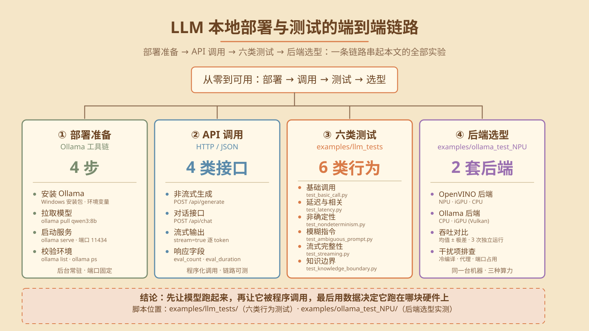
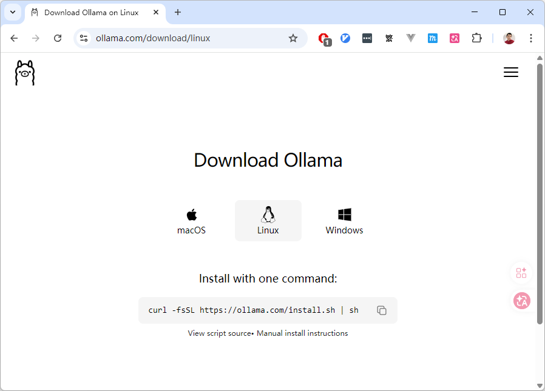
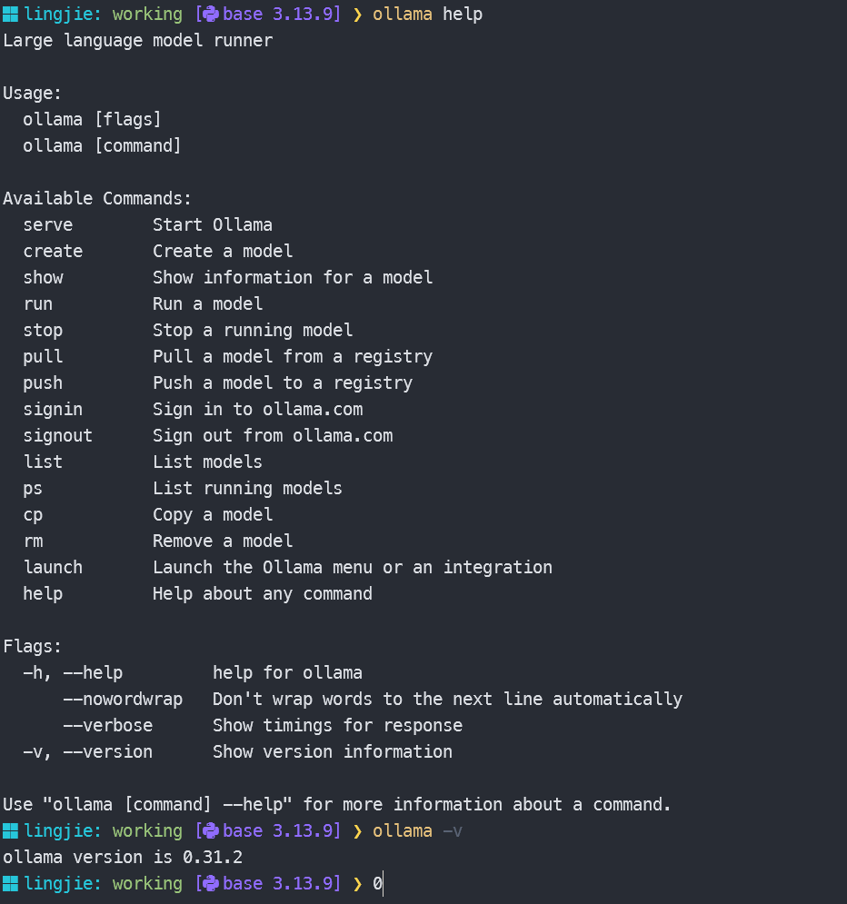
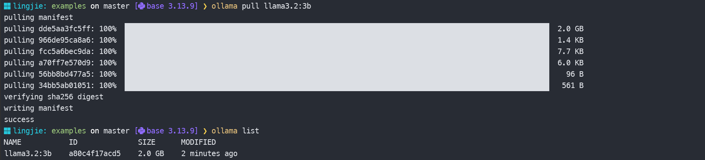
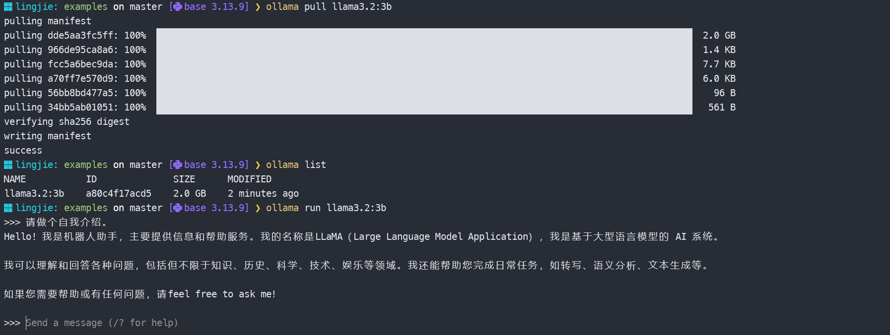
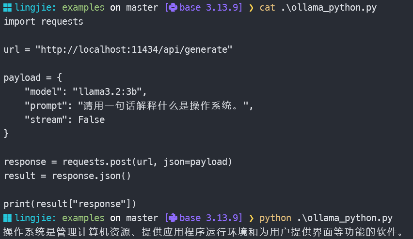
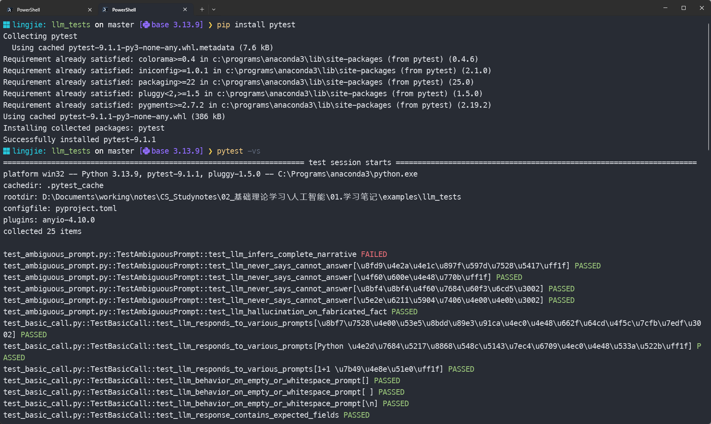
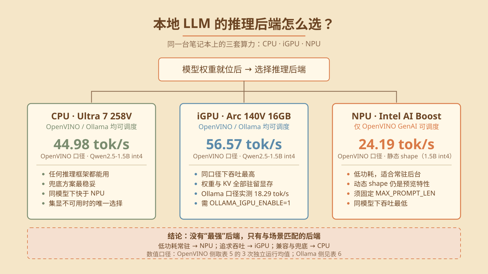
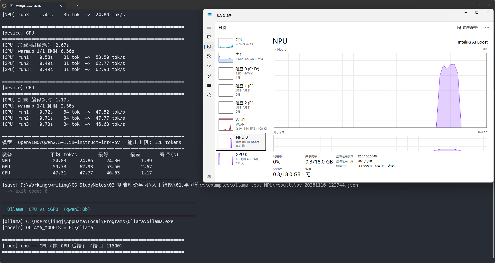
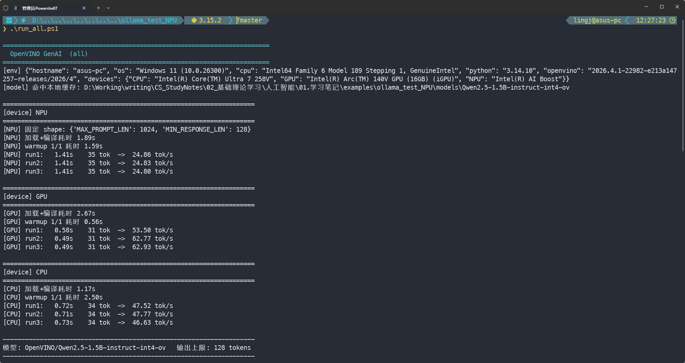

> [!NOTE] 笔记说明
>
> 这篇笔记对应的是《[[关于 AI 的学习路线图]]》一文中所规划的第三个学习阶段。用于记录我尝试将 LLM 部署到生产环境中，并对其展开能力边界测试的全过程，以及在该过程中所获得的心得体会。同样的，这些内容也将成为我 AI 系列笔记的一部分，被存储在本人 Github 上的[计算机学习笔记库](https://github.com/owlman/CS_StudyNotes)中，并予以长期维护。

本文的整体路线如图 1 所示：先在本地把 LLM 部署起来并跑通接口，再用六类测试刻画它的行为边界，最后用一次推理后端选型实验回答“模型究竟跑在哪块硬件上”。



**图 1**：LLM 本地部署与测试的端到端链路

## 关于 LLM 的本地部署

正如我之前在《[[关于 AI 的学习路线图]]》一文中所提到的，从学习的角度来说，如果我们要想切实了解 LLM 在计算机软件系统中所处的位置，以及它在生产环境中所扮演的角色，最直接的方式就是尝试将其部署到我们自己所在的计算机环境中，并通过测试来观察它与用户的交互方式。但是，如果想要实现在本地部署 LLM 这种大型应用，我们首先要解决一个很现实的问题：*如何用有限的硬件资源、以可控的方式将其运行起来*？

很显然，就目前阶段的学习任务来看，如果我们从直接编译源码、手动配置推理引擎、管理模型权重与依赖环境来着手，大概率会让自己的学习重心过早地偏向底层细节，而模糊了我们真正想观察的目标 —— LLM 在生产环境中所扮演的角色。因此，我个人会推荐读者从一款名为 Ollama 的开源模型管理工具来着手，该工具可以让人们在不必关心底层实现细节的情况下，快速地完成 LLM 的部署与测试。下面，就让我们来具体介绍一下 Ollama 及其使用方法。

> [!NOTE] 关于其他部署方式
>
> - 如果想直接基于深度学习框架来部署 LLM，也可以参考本文在“参考资料”一节中提供的视频教程：《基于 Transformer 库的 LLM 部署演示》。
> - 如果想基于 node-llama-cpp 来部署 LLM，也可以参考本文在“参考资料”一节中提供的博客文章：《基于 node-llama-cpp 的 LLM 部署演示》。

### 了解并安装 Ollama

Ollama 是一款基于 MIT 协议开源的、面向本地环境的 LLM 运行与管理工具，它的核心设计目标是以尽可能低的使用门槛，将“运行一个 LLM”这件事变成一项标准化、可重复的工程操作。具体来说就是，Ollama 在整个与 LLM 相关的系统中大致承担了以下职责：

- **模型生命周期管理**：负责模型的拉取、存储、版本管理与运行；
- **推理环境封装**：屏蔽底层推理引擎、量化方式与硬件差异；
- **统一的调用接口**：通过 CLI 或 API 的形式，对外提供一致的使用方式。

这意味着，用户在使用 Ollama 时并不需要关心模型权重具体存放在哪里、底层使用了哪种推理后端，也不必在一开始就纠结于 CUDA、Metal 或 CPU 优化等问题。很显然，我们在这里选择 Ollama，本质上是一种刻意降低系统复杂度的学习策略，目的是将学习重点放在观察模型本身的行为以及**它与系统其他部分的交互方式**上，但它并不足以应对实际生产环境中的所有问题。

Ollama 的安装过程本身非常简单，读者可以自行前往它的[官方下载页面](https://ollama.com/download)，并根据该页面中的提示，基于自己所在的操作系统完成安装即可，具体如图 2 所示。



**图 2**：Ollama 的下载页面

如果安装过程一切顺利，我们就可以通过在命令行中输入 `ollama help` 命令来验证安装是否成功。如果安装成功了，该命令会返回 Ollama 的使用提示信息，如图 3 所示。



**图 3**：Ollama 的使用提示信息

接下来，我们要做的就是选择一款适合当前学习任务的 LLM，并尝试使用 Ollama 来将其部署到我们的本地环境中。

### 选择并部署 LLM

关于应该选择什么模型来完成我们在这一阶段的学习，这主要取决于我们**要实验的任务类型**和**电脑配置**。下表 1 是我整理的当前主流候选模型。这张表初稿写于 2026 年 1 月底，模型列表已于 2026 年 11 月复核更新；表中同时给出“类别”行与“具体模型”行，前者标注该类别的代表模型，方便按需替换。

| 推荐模型 / 类别 | 主要特点与优势 | 适用场景 | 硬件要求参考 |
| --- | --- | --- | --- |
| **通用最佳平衡**（代表模型：`Qwen3-8B`） | 适用于多数学习场景的推荐起点；兼顾性能与成本。 | 适合一般学习和试验性部署。 | 建议 16GB+，量化后可在更低配置上运行。 |
| **Qwen2.5-7B** | 7B 级别综合性能强，指令跟随、长上下文支持好，通用性高。 | 文档总结、内容创作、知识问答、轻量级智能体任务。 | 16GB+ 内存，量化后可降低需求。 |
| **Llama 系列** | Meta 出品，生态完善，工具调用支持好；3.1 8B 适合通用对话，3.3 70B 性能更强。 | 快速对话、多语言任务、对响应速度要求高的应用。 | 8B 模型：8-16GB 内存；70B 需多卡或云端。 |
| **专注编程任务**（代表模型：`Qwen3-Coder-30B-A3B`） | 适合代码生成与开发辅助场景，语义理解更强。 | 专注于编程任务和开发者辅助。 | 建议 16GB+（MoE 结构，激活参数较少）；显存紧张时改选小尺寸版本。 |
| **Qwen3-Coder 系列** | 阿里出品，在代码理解和生成任务上表现优异，有不同尺寸可选。 | 代码解释、补全、测试、学习编程。 | 1.7B/4B/8B 等不同规格，可按需选择。 |
| **Mistral 系列** | Mistral AI 出品，通用能力强，在代码和推理任务上表现均衡。 | 通用对话、编程辅助、推理任务。 | 推荐 16GB 以上内存。 |
| **资源受限环境**（代表模型：`SmolLM3-3B` / `Llama 3.2 3B`） | 适合低配设备和入门部署的轻量级模型。 | 适用于硬件受限的实验环境、边缘设备和教学演示。 | 8-16GB 内存即可。 |
| **SmolLM3-3B** | 完全开源，性能优秀，在 3B 级别中表现出色，可控性强。 | 对开源合规要求高，或需要在低配硬件上部署。 | 可在普通笔记本电脑上运行。 |
| **Llama 3.2 3B** | 体积小、速度快，适合部署在多种设备上，对硬件要求低。 | 需要即时响应的嵌入式应用或移动端场景。 | 8-16GB 内存即可。 |

**表 1**：常见 LLM 模型选型参考

> 表中的“类别”行给出该类别的代表模型，具体尺寸与许可条款请以各模型官方仓库为准。本文后续的实测配置为：OpenVINO 侧用 `OpenVINO/Qwen2.5-1.5B-instruct-int4-ov`，Ollama 侧用 `qwen3:8b`。

根据上面的表格，我们可以先参照以下提示来确定选择：

- 如果硬件资源不给力（例如内存容量只有 16GB 或更少，没有独立显卡），可以选择`SmolLM3-3B`或`Llama 3.2 3B`；
- 如果想优先考虑通用对话和写作，可以选择`Qwen2.5-7B`或`Llama 3.1 8B`；
- 如果想优先考虑将其用于编程辅助，`Qwen3-Coder`系列可能是更好的选择；

由于这篇笔记的任务是基于学习的目的来部署 LLM，它最好能让读者在最普通的个人笔记本上进行过程相对流畅的实验，因此我决定选择`Llama 3.2 3B`来进行演示。这个选择体现了本地部署学习中的常见折中：我们不追求大规模生产级模型的最优性能，而是优先保证可用性、可重复性和测试便利性。

基本上，使用 Ollama 部署 LLM 的操作步骤与使用 docker 部署服务端应用的过程非常类似，具体如下：

1. **拉取模型**：打开命令行终端并输入`ollama pull llama3.2:3b`命令，即可从 Ollama 的官方服务器上拉取我们所选择的 LLM 镜像，如图 4 所示。

    

    **图 4**：使用 Ollama 拉取 LLM 镜像

2. **运行测试**：继续在图 4 所示命令行界面中输入 `ollama run llama3.2:3b`命令即可开始交互测试。在这里，我们演示的是一个 LLM 版的“Hello World”，如图 5 所示。

    

    **图 5**：使用 Ollama 运行 LLM 镜像

至此，我们就算完成了一次基于 Ollama 的 LLM 本地部署作业。需要特别强调的是，由于受到硬件资源的限制，我们在这里所部署的这个 LLM 在功能上是远远不能满足实际生产需求的，它在这里的任务只是供我们用测试的方式来观察 LLM 在生产环境中所扮演的角色。

### 从交互式运行到服务模式

在上面的演示中，我们使用的 `ollama run` 是一个交互式命令——它会启动模型并打开一个对话界面。这种方式适合手动体验，但如果要通过编程方式调用 LLM（例如编写测试脚本），就需要切换到 **服务模式（Server Mode）**。

Ollama 在后台默认运行着一个守护进程（安装后会自动注册为系统服务），监听 `localhost:11434` 端口。你可以通过以下命令手动启动它：

```bash
ollama serve
```

服务模式启动后，Ollama 会提供给我们一套 RESTful API，所有与模型的交互都通过 HTTP 请求来完成。切换到服务模式意味着：

- **调用方式**：从 `ollama run` + 手动输入文本，变成 POST 请求 + 程序化处理的 JSON 响应；
- **生命周期**：从单次对话的临时交互，变成模型常驻内存、持续接受请求的服务进程；
- **并发与排队**：Ollama 在服务模式下默认串行处理请求，意味着多个客户端同时调用时后续请求会排队等待，这是生产部署中需要重点关注的约束。

### 部署环境初始化与预热

在开始编写测试之前，还有几个工程步骤需要先处理好：

1. **确认服务可用**：确保 Ollama 服务正在运行，且目标模型已加载到内存中。可以通过 `curl http://localhost:11434/api/generate` 快速验证。
2. **模型预热（Warm-up）**：大模型在首次推理时通常比后续调用慢得多（涉及显存分配、KV cache 初始化等），因此在进行性能相关的测试前，最好先发一条无关请求完成预热。
3. **错误处理策略**：Ollama API 在模型未加载或请求超时的情况下可能返回 500 或连接拒绝。测试框架需要准备好重试逻辑和超时设置，而不是假设服务永远可用。

这些步骤虽然不是“核心知识”，但忽略了它们会让后面的测试结果充满噪声。因此，我在 conftest.py 中设置的 `timeout=120` 和 `raise_for_status()` 就是为了应对这些现实问题。

#### 局域网部署的一个坑：requests 会走系统代理

如果读者把端点从 `localhost` 换成局域网主机名（例如把 Ollama 装在另一台机器上，用 `http://my-openclaw:11434/api/generate` 访问），很可能会遇到一个和 LLM 毫无关系、但从错误信息里完全看不出来的失败：

```text
requests.exceptions.HTTPError: 502 Server Error: Bad Gateway for url:
http://my-openclaw:11434/api/generate
```

这个 `502` **不是 Ollama 返回的，而是代理服务器返回的**。原因在于 `requests` 的代理绕过逻辑存在三个盲区（我的实测环境：Windows 11 + Python 3.13 + requests 2.32；2026 年 11 月复核时本机 requests 已升级到 2.34.2，下面的结论在两个版本上均成立）：

1. 它只读 `NO_PROXY` **环境变量**，不读 Windows 注册表里的 `ProxyOverride`。所以浏览器里明明把 `my-openclaw` 加进了代理例外，Python 脚本照样走代理；
2. 对**主机名**目标而言，`NO_PROXY` 里的**主机名字符串**才是匹配依据。写 `192.168.0.0/16` 这种 CIDR 网段对 `my-openclaw` **不会**生效，因为 `requests` 不会先把 `my-openclaw` 解析成 `192.168.31.62` 再套网段。

   这里还需要补充一个容易被误传的细节：若 URL 中的主机本身就是 IP 字面量，`requests` 2.32+ 的 `should_bypass_proxies()` 其实支持 CIDR（内部有 `is_valid_cidr()` 与 `address_in_network()` 判定），只是这条路径覆盖不到局域网主机名，因此不能概括成“`requests` 不支持 CIDR”。
3. 于是主机名 `my-openclaw` 既不等于 `localhost`、也不在 `NO_PROXY` 的字符串列表里 → 请求被交给本机代理 → 代理在另一台机器上解析不到这个局域网主机名 → 回 `502 Bad Gateway`。

上面第 1 条并不是 `requests` 的偶然实现，而是 Python 标准库在 Windows 上的既定策略：CPython 的 `Lib/urllib/request.py` 在 Windows 分支下，`proxy_bypass()` 只有在**环境中不存在任何代理相关变量**时，才会回落到注册表的 `ProxyOverride`。

而只要 `HTTP_PROXY`、`HTTPS_PROXY`、`ALL_PROXY` 乃至 `NO_PROXY` 任意一个存在，绕过判定就完全由环境变量完成，注册表里的例外列表根本不会被读取。换句话说，在已经配了代理的机器上，“把主机名加进系统代理例外”这条浏览器侧的操作，对 Python 脚本天然无效。

用 `curl` 一对比就能确认问题出在代理而不是服务：

```bash
curl -s --noproxy '*' http://my-openclaw:11434/api/tags   # 直连，正常返回模型列表
curl -s -x http://127.0.0.1:12450 http://my-openclaw:11434/api/tags   # 走代理，空响应
```

最省事的修法是在脚本里直接关掉代理继承，而不是去改系统环境变量：

```python
SESSION = requests.Session()
SESSION.trust_env = False   # 忽略 HTTP_PROXY / HTTPS_PROXY / ALL_PROXY，直连
```

> **教训**：局域网服务（Ollama、vLLM、内部 API）一律不该走公网代理。做这类连通性排查时，先确认错误是“服务返回的”还是“代理返回的”——`curl --noproxy '*'` 与默认行为各跑一次，就能把责任方分开。

## 针对 LLM 的测试与观察

现在，让我们来具体测试一下这个基于 Ollama 完成本地部署的 LLM。需要明确的是，我们这里的测试任务并不是在评估模型的“聪明程度”，而是设法通过一组尽可能简单、可复现的测试来观察 LLM 与用户交互时的行为模式。换句话说，我们希望通过测试来了解 **LLM 作为系统组件时的响应方式、失败模式以及可控性边界。**

在测试方式的选择上，我选择使用 Python 脚本通过 HTTP API 的方式来调用本地运行的 LLM，用于模拟更接近实际生产环境的使用场景。

### 使用 Python 调用本地 Ollama 模型

在默认情况下，Ollama 会在本地运行 LLM 的同时为用户提供一套 RESTful API（具体文档请参考本文最后的“参考资料”），这让我们可以使用 Python 脚本来模拟 HTTP 客户端，从而实现对 LLM 的自动化测试。其基本调用步骤如下：

1. **启动 LLM**：在命令行终端中输入`ollama run llama3.2:3b`命令，启动 LLM 的本地运行实例。

2. **创建 Python 脚本**：创建一个名为 `ollama_run_test.py` 的 Python 脚本，并在其中输入以下代码：

    ```python
    import requests

    url = "http://localhost:11434/api/generate"

    payload = {
        "model": "llama3.2:3b",
        "prompt": "请用一句话解释什么是操作系统。",
        "stream": False
    }

    response = requests.post(url, json=payload, timeout=120)
    response.raise_for_status()
    result = response.json()

    print(result["response"])
    ```

    如果读者需要一个包含局域网部署选项的完整测试示例（含 timeout / 错误处理 / 双端点调用 / 代理绕过）见 [examples/test_ollama_run.py](./examples/test_ollama_run.py)。

3. **运行 Python 脚本**：在命令行终端中输入 `python ollama_run_test.py` 命令，运行 Python 脚本，即可看到 LLM 的输出结果，如图 6 所示。

    

    **图 6**：使用 Python 调用 Ollama API

在上述示例中，我们首先定义了 Ollama API 的调用地址，然后构造了一个包含模型名称、提示词以及是否以流式方式返回结果的请求体。最后，我们通过 requests 库的 post 方法将请求发送给 Ollama API，并打印出返回结果，这个示例的意义并不在于输出内容本身，而在于确认以下几点：

- Ollama API 是否能够被稳定调用；
- 请求—响应链路是否完整；
- 返回结果是否符合预期的数据结构。

在确认了 LLM 的调用链路是完整且稳定的前提下，我们接下来就可以正式开始编写测试用例了。

### 使用 PyTest 编写测试用例

现在，我们的任务是基于上面搭建的这个**最小可用的测试环境**，结合 PyTest 自动化测试框架来编写一个用于观察 LLM 行为模式的测试用例，具体步骤如下：

#### 测试项目的骨架

- **步骤 1：新建测试项目**：在计算机的任意位置上创建一个名为`llm_tests`的目录（在这里，我将它建在这篇笔记所在目录下的`examples`目录中），并在其中创建下列 Python 脚本文件：

    ```bash
    llm_tests
    ├── conftest.py                  # PyTest 公共配置与 fixtures
    ├── pyproject.toml               # 项目依赖配置
    ├── README.md                    # 项目说明
    ├── test_ambiguous_prompt.py     # 模糊指令下的模型行为测试
    ├── test_basic_call.py           # 基础连通性测试
    ├── test_knowledge_boundary.py   # 知识边界与幻觉行为测试
    ├── test_latency.py              # 响应延迟测试
    ├── test_nondeterminism.py       # 非确定性输出测试
    └── test_streaming.py            # 流式响应行为测试
    ```

#### 公共配置：把调用细节藏进 fixture

- **步骤 2：编写项目公共配置**：使用代码编辑器打开`conftest.py`文件，并其中输入以下代码：

    ```python
    # llm_tests/conftest.py
    '''
    PyTest 公共配置，提供调用 LLM 的基础 fixture。
    本文件对应主文章中"概率方法 → 数据驱动"这一范式转变中的测试基础设施层：
    测试的可靠性与可复现性，从根本上取决于底层调用的可控程度。
    '''
    import json
    import os
    import pytest
    import requests

    # 端点与模型可通过环境变量覆盖，方便在局域网机器上跑同一套测试：
    #   set OLLAMA_URL=http://my-openclaw:11434/api/generate
    #   set OLLAMA_MODEL=qwen3:4b-8k
    OLLAMA_URL = os.environ.get("OLLAMA_URL", "http://localhost:11434/api/generate")
    MODEL_NAME = os.environ.get("OLLAMA_MODEL", "llama3.2:3b")
    # 局域网上的较大模型（如 qwen3:4b-8k）首次加载 + 推理可能超过 120s，
    # 超时可用 OLLAMA_TIMEOUT 覆盖。
    REQUEST_TIMEOUT = float(os.environ.get("OLLAMA_TIMEOUT", "120"))

    # 共享 Session，且强制忽略环境里的代理变量。
    # 本机装有 HTTP 代理（HTTP_PROXY/ALL_PROXY），而 requests 的代理绕过规则
    # 对"主机名"目标只做字符串匹配：既不把主机名解析成 IP 再套 CIDR 网段
    # （如 NO_PROXY 里的 192.168.0.0/16 对 my-openclaw 不生效），也不读 Windows
    # 注册表的 ProxyOverride（只要环境里存在任意代理变量，urllib 就不会回落注册表）。
    # 注意：requests 2.32+ 对"IP 字面量"目标本身是支持 CIDR 匹配的
    # （should_bypass_proxies 内部有 is_valid_cidr / address_in_network），
    # 但那条路径覆盖不到局域网主机名。
    # 一旦把 URL 改成局域网主机名（如 my-openclaw），请求就会被代理接管，
    # 代理机解析不到该名字，返回 502 Bad Gateway。
    SESSION = requests.Session()
    SESSION.trust_env = False


    @pytest.fixture
    def ollama_url():
        '''
        实际使用的 Ollama 端点（可由环境变量 OLLAMA_URL 覆盖）。
        '''
        return OLLAMA_URL


    @pytest.fixture
    def model_name():
        '''
        实际使用的模型名（可由环境变量 OLLAMA_MODEL 覆盖）。
        '''
        return MODEL_NAME


    @pytest.fixture
    def request_timeout():
        '''
        单次请求的超时秒数（可由环境变量 OLLAMA_TIMEOUT 覆盖）。
        '''
        return REQUEST_TIMEOUT


    @pytest.fixture
    def http_session():
        '''
        共享的直连 HTTP Session。
        测试中所有对 Ollama 的请求都应经由它发起，避免走系统代理。
        '''
        return SESSION


    @pytest.fixture
    def ollama_client():
        '''
        基础调用 fixture，封装 Ollama 的 generate API。
        返回一个可接受 prompt 和可选参数字典的闭包。
        '''
        def call_llm(prompt, stream=False, options=None):
            payload = {
                "model": MODEL_NAME,
                "prompt": prompt,
                "stream": stream,
            }
            if options:
                payload["options"] = options
            response = SESSION.post(
                OLLAMA_URL,
                json=payload,
                timeout=REQUEST_TIMEOUT,
            )
            response.raise_for_status()
            return response.json()
        return call_llm


    @pytest.fixture
    def deterministic_client(ollama_client):
        '''
        确定性调用 fixture：固定 temperature=0, seed=42。
        对应主文章中"非确定性输出"的对照实验——在参数固定时，
        模型输出是否仍存在不可控的波动？
        '''
        def call_deterministic(prompt, stream=False):
            return ollama_client(
                prompt,
                stream=stream,
                options={"temperature": 0, "seed": 42}
            )
        return call_deterministic


    @pytest.fixture
    def stream_collector():
        '''
        流式响应收集器，用于测试 stream=True 时的逐 token 行为。
        Ollama 流式 API 每行返回一个 JSON 对象，最后一行 {"done": true}。
        '''
        def collect(url, payload):
            response = SESSION.post(url, json=payload, stream=True, timeout=REQUEST_TIMEOUT)
            response.raise_for_status()
            tokens = []
            for line in response.iter_lines(decode_unicode=True):
                if not line:
                    continue
                chunk = json.loads(line)
                if chunk.get("done"):
                    break
                tokens.append(chunk.get("response", ""))
            return "".join(tokens)
        return collect
    ```

#### 六个测试文件：从连通性到行为边界

- **步骤 3：编写基础连通性测试**：使用代码编辑器打开`test_basic_call.py`文件，并其中输入以下代码：

    ```python
    # llm_tests/test_basic_call.py
    '''
    基础连通性与响应结构测试。

    测试目标：
    - LLM API 是否可被稳定调用（对应主文章中"概率转向"的基础假设：系统应可被可靠地查询）；
    - 响应数据结构是否符合预期；
    - 模型对不同类型指令是否都能产出非空且有意义的回复。

    这些测试是后续所有观察的基线——如果基础调用就不可靠，
    那么对"非确定性""模糊推断"等高级行为的分析就失去了立足点。
    '''
    import pytest


    class TestBasicCall:

        @pytest.mark.parametrize("prompt", [
            "请用一句话解释什么是操作系统。",
            "Python 中的列表和元组有什么区别？",
            "1+1 等于几？",
        ])
        def test_llm_responds_to_various_prompts(self, ollama_client, prompt):
            '''对不同类型的指令，模型都应返回非空字符串响应。'''
            result = ollama_client(prompt)

            assert "response" in result, "响应中缺少 'response' 字段"
            assert isinstance(result["response"], str), "'response' 字段应为字符串"
            assert len(result["response"].strip()) > 0, "响应内容不应为空"

        @pytest.mark.parametrize("prompt", [
            "",
            " ",
            "\n",
        ])
        def test_llm_behavior_on_empty_or_whitespace_prompt(
                self, ollama_client, prompt):
            '''
            边界情况：空或纯空白指令。
            这类输入在传统 API 中应返回 4xx 错误，
            但 LLM API 的行为值得观察——它会如何"应对"无意义的输入？
            '''
            result = ollama_client(prompt)
            response_text = result["response"].strip()

            # 模型不会因为空输入而崩溃（服务可用），
            # 但输出内容可能是不确定的默认回复
            assert isinstance(response_text, str)

        def test_llm_response_contains_expected_fields(self, ollama_client):
            '''验证 Ollama API 返回的完整字段集合。'''
            result = ollama_client("Hello。")

            # 核心字段存在性检查
            assert "model" in result
            assert "response" in result
            assert "done" in result
            assert "eval_count" in result
            assert "eval_duration" in result
            assert result["done"] is True
    ```

- **步骤 4：编写响应延迟测试**：使用代码编辑器打开`test_latency.py`文件，并其中输入以下代码：

    ```python
    # llm_tests/test_latency.py
    '''
    响应延迟与吞吐量观察测试。

    测试目标：
    - LLM 的响应时间是否在可接受范围内（工程部署的关键约束）；
    - 输出长度与延迟之间是否存在可预测的关系；
    - 模型在多轮调用后是否出现性能衰减。

    对应主文章中"有限理性"（Bounded Rationality）的概念——在任何实际系统中，
    响应时间都是智能决策的硬约束。一个"正确但太慢"的模型在工程上是不可用的。
    '''
    import time
    import statistics


    class TestLatency:

        def test_llm_response_not_instant(self, ollama_client):
            '''
            验证 LLM 的推理是计算密集型操作，不会瞬时返回。
            这是区分"检索"与"生成"两种行为模式的基本观察。
            '''
            start = time.time()
            result = ollama_client("请简要说明 TCP 和 UDP 的区别。")
            elapsed = time.time() - start
            # 判定依据不是某个魔法阈值，而是"服务端确实做了生成"：
            # Ollama 在返回体里给出 eval_count（实际生成的 token 数）。
            assert result.get("eval_count", 0) > 0, (
                "服务端返回 eval_count=0，说明这次调用没有发生实际生成"
            )
            # 即使是最简单的推理也需要非零时间→生成不是查找
            assert elapsed > 0.1, (
                f"响应过快（{elapsed:.3f}s），可能未触发实际推理"
            )

        def test_latency_scales_with_output_length(self, ollama_client):
            '''
            验证输出长度与延迟的相关性。
            短指令应比长指令更快返回，如果差异不明显，
            说明瓶颈可能在输入处理（prefill）而非生成（decode）。
            这对于判断系统瓶颈所在有直接的工程参考价值。
            '''
            prompts = {
                "short": "什么是递归？请用一句话回答。",
                "medium": "请详细解释递归算法的原理，并给出至少三个不同领域的应用示例。",
            }
            latencies = {}

            for label, prompt in prompts.items():
                start = time.time()
                result = ollama_client(prompt)
                elapsed = time.time() - start
                latencies[label] = {
                    "time": elapsed,
                    "tokens": result.get("eval_count", 0),
                }

            # "medium" 通常应比 "short" 生成更多 token
            short_tokens = latencies["short"]["tokens"]
            medium_tokens = latencies["medium"]["tokens"]
            assert medium_tokens > short_tokens, (
                f"长指令生成的 token 数（{medium_tokens}）应大于短指令（{short_tokens}）"
            )
            # 相关性检查：多出来的 token 必须转化为额外的时间，
            # 且折算出的每 token 解码耗时需落在合理区间（不与实测吞吐矛盾）。
            # 只比较 token 数并不足以证明"延迟随输出长度增长"。
            time_delta = latencies["medium"]["time"] - latencies["short"]["time"]
            token_delta = medium_tokens - short_tokens
            assert time_delta > 0, (
                f"输出 token 数增加了 {token_delta}，总耗时却反而更短"
                f"（{time_delta:.2f}s），延迟与输出长度没有正相关"
            )
            seconds_per_token = time_delta / token_delta
            assert 0.001 < seconds_per_token < 1.0, (
                f"折算每 token 耗时 {seconds_per_token * 1000:.1f}ms 不在合理区间"
                "（应在 1ms~1000ms 之间），延迟数据可能受到其他因素干扰"
            )

        def test_latency_consistency_across_calls(self, ollama_client):
            '''
            多轮调用的延迟稳定性。
            如果延迟波动过大（如第一轮远慢于后续轮次），可能涉及
            模型加载预热、缓存策略等工程因素，需要在生产设计中加以考虑。
            '''
            prompt = "请用一句话解释什么是操作系统。"
            timings = []

            for _ in range(3):
                start = time.time()
                ollama_client(prompt)
                timings.append(time.time() - start)

            # 计算变异系数（CV），度量延迟的相对离散程度
            mean_latency = statistics.mean(timings)
            stdev_latency = statistics.stdev(timings) if len(timings) > 1 else 0
            cv = stdev_latency / mean_latency if mean_latency > 0 else 0

            # 变异系数建议不超过 50%，如果超过说明延迟极不稳定
            assert cv < 0.5, (
                f"延迟变异系数 CV={cv:.2%}，波动过大，"
                f"各轮延迟分别为 {[f'{t:.2f}s' for t in timings]}"
            )
    ```

- **步骤 5：编写非确定性输出测试**：使用代码编辑器打开`test_nondeterminism.py`文件，并其中输入以下代码：

    ```python
    # llm_tests/test_nondeterminism.py
    '''
    非确定性输出测试——LLM 的核心特性之一。

    测试目标：
    - 在默认参数（temperature>0）下，同一 prompt 的输出是否具有多样性；
    - 在固定参数（temperature=0, seed=42）下，输出是否可复现；
    - 非确定性是否影响关键信息的一致性（事实类回答偏差）。

    对应主文章中"概率转向"的核心洞察：LLM 本质上是一个概率模型，
    其输出是分布上的采样而非确定性计算。这一特性既是灵活性的来源，
    也是工程可靠性的挑战。
    '''


    class TestNondeterminism:

        def test_default_output_is_diverse(self, ollama_client):
            '''
            在默认参数（temperature 未指定）下，多次调用同一 prompt，
            输出应大概率不同。这个测试直接验证 LLM 的"概率采样"本质。
            '''
            prompt = "请用一句诗形容秋天的黄昏。"
            outputs = []

            for _ in range(3):
                result = ollama_client(prompt)
                outputs.append(result["response"].strip())

            unique_outputs = set(outputs)
            # 三次调用至少应出现两种不同的回答
            assert len(unique_outputs) >= 2, (
                f"三次调用输出了完全相同的文本，说明采样机制可能未生效。"
            )

        def test_deterministic_output_is_repeatable(
                self, deterministic_client):
            '''
            在固定 temperature=0, seed=42 的条件下，
            多次调用应产生完全一致的输出。
            这对工程可复现性和调试至关重要。
            '''
            prompt = "请给出一个 JSON，对象中包含 name 和 age 两个字段。"
            outputs = []

            for _ in range(3):
                result = deterministic_client(prompt)
                outputs.append(result["response"].strip())

            # 固定参数下输出应完全一致
            assert all(o == outputs[0] for o in outputs), (
                "固定 temperature=0, seed=42 时输出仍不一致，"
                "可能涉及其他随机性来源（如采样后端、硬件浮点差异）"
            )

        def test_nondeterminism_affects_factual_consistency(self, ollama_client):
            '''
            非确定性对事实类回答的影响测试。
            即使 temperature 较低，模型在不同次调用中
            对已知事实的表述细节可能不同，
            但核心信息应保持一致。

            此测试不判定"对错"，而是观察偏差的类型和幅度。
            '''
            prompt = "光速大约是多少？请给出具体数值和单位。"
            responses = []

            for _ in range(3):
                result = ollama_client(prompt)
                responses.append(result["response"].strip())

            # 验证每次回答都包含"千米/秒"或"m/s"之类的单位关键词
            unit_keywords = ["千米/秒", "km/s", "米/秒", "m/s", "×10⁸"]
            for resp in responses:
                has_unit = any(kw in resp for kw in unit_keywords)
                assert has_unit, (
                    f"回答缺少单位：{resp[:50]}..."
                )
    ```

- **步骤 6：编写模糊指令测试**：使用代码编辑器打开`test_ambiguous_prompt.py`文件，并其中输入以下代码：

    ```python
    # llm_tests/test_ambiguous_prompt.py
    '''
    模糊指令下的模型行为测试。

    测试目标：
    - 当输入信息不完整时，模型是主动推断/补全，还是要求澄清；
    - 模型是否会产生"幻觉"——即生成看似合理但无依据的内容；
    - 模糊程度与输出长度之间的关联。

    对应主文章中"符号主义的脆性"与"概率转向的不确定性推理"之间的矛盾：
    符号系统在输入超出规则边界时直接崩溃，而概率模型会尝试"猜"——但可能猜错。
    理解这个差异，是在工程中设计 LLM 接口的关键前提。
    '''
    import pytest


    class TestAmbiguousPrompt:

        def test_llm_infers_complete_narrative(self, ollama_client):
            '''
            当 prompt 信息不足时，模型不会报错或要求澄清，
            而是自己"脑补"出一个完整的叙述。
            这是概率模型与确定性系统最核心的行为差异。
            '''
            prompt = "请判断这个方案是否合理。"
            result = ollama_client(prompt)
            response_text = result["response"]

            # 模型会生成完整叙述而非简单报错
            assert len(response_text) > 50, (
                "模型对模糊指令的回应过短，可能未触发推理"
            )

        @pytest.mark.parametrize("ambiguous_prompt", [
            "这个东西好用吗？",
            "你怎么看？",
            "说说你的想法。",
            "帮我处理一下。",
        ])
        def test_llm_never_says_cannot_answer(
                self, ollama_client, ambiguous_prompt):
            '''
            模型几乎不会承认"你的问题信息不足"，
            而是总会基于上下文（即使是空上下文）给出某种回答。
            这是工程设计中必须考虑的安全隐患——

            在确定性系统中，信息不足应导致错误返回；
            在 LLM 中，信息不足导致"编造"。
            '''
            result = ollama_client(ambiguous_prompt)
            response_text = result["response"]

            # 模型不会给出"拒绝回答"类型的回应
            refusal_patterns = [
                "无法回答", "信息不足", "没有足够",
                "cannot answer", "insufficient",
            ]
            has_refusal = any(p in response_text for p in refusal_patterns)

            # 即使有拒绝措辞，也要验证后续是否仍生成了内容
            assert not has_refusal or len(response_text) > 100, (
                f"模型对模糊指令 '{ambiguous_prompt}' 给出了简短拒绝："
                f"{response_text[:80]}"
            )

        def test_llm_hallucination_on_fabricated_fact(self, ollama_client):
            '''
            幻觉测试：询问一个虚构的概念。
            观测模型是否有能力承认"不知道"，
            还是会基于语言模式生成一个看似合理的解释。
            '''
            prompt = "请解释什么是『量子热力学中的卡西米尔-普罗米修斯效应』。"
            result = ollama_client(prompt)
            response_text = result["response"]

            # 这个效应是虚构的，如果模型生成了一大段言之凿凿的解释，
            # 就说明产生了"流畅的幻觉"
            import re
            # 检查是否包含"抱歉""没有""虚构"等自我怀疑标记
            uncertainty = re.search(r"(抱歉|对不起|没有(这个|找到|听说)|虚构|不存在|不熟悉)", response_text)
            if not uncertainty:
                # 如果模型没有表现出不确定性，输出可能是在编造
                # 这时至少希望输出中包含基础的科学线索
                warnings = ["卡西米尔", "Casimir", "量子", "热力学", "效应", "推测", "假设"]
                has_sci_context = any(w in response_text for w in warnings)
                assert has_sci_context, (
                    "模型可能产生了流畅的幻觉：\n"
                    f"{response_text[:200]}"
                )
    ```

- **步骤 7：编写流式响应测试**：使用代码编辑器打开`test_streaming.py`文件，并其中输入以下代码：

    ```python
    # llm_tests/test_streaming.py
    '''
    流式（Streaming）响应行为测试。

    测试目标：
    - 流式模式下，内容是否能逐 token 完整返回；
    - 流式结果与非流式结果在语义上是否一致；
    - 流式传输是否存在丢 token 或乱序问题。

    对应主文章中"工程与社会软约束"一节：在面向用户的实时场景中，
    流式接口的可靠性直接影响产品体验。流式本身是 LLM 时代
    区别于传统 API 的标志性交互范式。
    '''
    import json
    import re
    # 按标点切分文本，用于提取"关键短语"
    CLAUSE_SPLIT = re.compile(r"[，。！？；、\n\r,.;!?]+")
    def extract_clauses(text, min_len=4):
        """
        把一段文本按标点切成短语片段，并过滤掉过短的片段。
        比"字符集重叠"更贴近"是否丢了内容"这一本意。
        """
        parts = [p.strip() for p in CLAUSE_SPLIT.split(text)]
        return [p for p in parts if len(p) >= min_len]
    class TestStreaming:

        def test_stream_output_completeness(self, ollama_client, stream_collector, ollama_url, model_name):
            '''
            验证流式模式能完整收集到所有 token，
            不会提前截断或丢失尾部内容。
            '''
            prompt = "请用 50 字以内说明递归函数的出口条件为什么重要。"
            # 非流式结果作为参照；固定 temperature=0 以尽量消除采样随机性，
            # 否则两次调用的措辞差异会被误判成"传输丢内容"
            non_stream = ollama_client(
                prompt,
                stream=False,
                options={"temperature": 0}
            )
            full_text = non_stream["response"]
            # 流式收集
            url = ollama_url
            payload = {
                "model": model_name,
                "prompt": prompt,
                "stream": True,
                "options": {"temperature": 0},
            }
            streamed_text = stream_collector(url, payload)
            assert len(streamed_text) > 0, "流式模式未收集到任何 token"
            # 语义一致性检验：提取关键短语并统计命中率
            clauses = extract_clauses(full_text)
            assert clauses, "非流式结果未解析出任何关键短语"
            matched = [c for c in clauses if c in streamed_text]
            hit_rate = len(matched) / len(clauses)
            assert hit_rate >= 0.5, (
                f"流式结果的关键短语命中率仅 {hit_rate:.0%}"
                f"（{len(matched)}/{len(clauses)}），可能存在丢 token 或截断"
            )

        def test_stream_token_by_token(
            self, ollama_client, stream_collector, http_session, ollama_url, model_name, request_timeout
        ):
            '''
            观察逐 token 的粒度。
            Ollama 的流式接口按 token 粒度输出（非字符），
            因此单次 chunk 可能包含空格或标点，但不应为空。
            '''
            url = ollama_url
            payload = {
                "model": model_name,
                "prompt": "Hello!",
                "stream": True,
            }

            response = http_session.post(url, json=payload, stream=True, timeout=request_timeout)
            response.raise_for_status()

            token_count = 0
            for line in response.iter_lines(decode_unicode=True):
                if not line:
                    continue
                chunk = json.loads(line)
                if chunk.get("done"):
                    break
                token_text = chunk.get("response", "")
                # 检查每个 chunk 格式是否正确
                assert isinstance(token_text, str), f"chunk 中的 response 不是字符串：{chunk}"
                token_count += 1

            # 至少产生了多个 token
            assert token_count > 5, (
                f"仅产生了 {token_count} 个 token，流式粒度异常"
            )
    ```

- **步骤 8：编写知识边界测试**：使用代码编辑器打开`test_knowledge_boundary.py`文件，并其中输入以下代码：

    ```python
    # llm_tests/test_knowledge_boundary.py
    '''
    知识边界与幻觉行为测试。

    测试目标：
    - 模型对于自身知识范围之外的问题（如训练数据截止后的事件）如何回应；
    - 模型是否区分"已知事实"与"推测"；
    - 模型面对自我指涉的问题（关于自身的问题）是否会暴露内部状态。

    对应主文章中"哥德尔不完备与形式系统内的自我指涉"一节：
    如果 LLM 基于"形式化"的统计模式运作，它就无法真正"理解"
    自身知识边界的形状——它会编造，而非承认无知。
    '''
    import pytest


    class TestKnowledgeBoundary:

        @pytest.mark.parametrize("question,expected_clue", [
            ("2025 年诺贝尔物理学奖颁给了谁？", "2025"),
            ("2026 年世界杯足球赛在哪里举办？", "2026"),
        ])
        def test_knowledge_cutoff_handling(
                self, ollama_client, question, expected_clue):
            '''
            测试模型对训练数据截止日期之后的事件的反应。
            模型的知识在预训练完成时已冻结，"不知道"应为合理的回应方式。
            但我们实际上观察到的是：模型经常假装知道并编造答案。
            '''
            result = ollama_client(question)
            response_text = result["response"]

            # 模型可能给出看起来"合理"的回答（幻觉），
            # 也可能承认不知道。
            # 这里我们不判断"正确性"，而是看它是否表现出不确定性
            uncertainty_markers = [
                "不确定", "截至", "不知道", "没有信息",
                "训练数据", "无法确认", "not sure", "截止",
            ]
            has_uncertainty = any(m in response_text for m in uncertainty_markers)

            # 如果有年份关键词出现在回答中但不含不确定性，可能是流畅的幻觉
            if expected_clue in response_text and not has_uncertainty:
                # 至少要求回答在语法上是完整叙述
                assert len(response_text) > 30

        def test_self_referential_question(self, ollama_client):
            '''
            自我指涉问题测试：询问模型关于自身的信息。
            模型可能给出看起来合理但实际上不正确
            （或训练数据中常见的模板化）的回答。
            '''
            questions = [
                "你现在使用的是哪个版本的 Transformer 架构？",
                "你的训练数据截止到什么时候？",
            ]
            for q in questions:
                result = ollama_client(q)
                response_text = result["response"]

                # 模型一定会给出一个具体的数字或版本号，
                # 但无法从系统层面验证其正确性
                assert len(response_text) > 20

        def test_factual_confidence_by_domain(self, ollama_client):
            '''
            观察模型在不同知识领域中的自信程度差异。
            通常模型在常识领域（数学、物理）表现出高自信，
            在冷门领域表现出高幻觉率，这不是偶然，
            而是训练数据分布的自然结果。
            '''
            prompts = [
                ("常识", "地球绕太阳公转一周需要多长时间？"),
                ("冷门", "什么是布拉格-朗道理论？请用一句话概括。"),
            ]
            for domain, prompt in prompts:
                result = ollama_client(prompt)
                response_text = result["response"]
                assert len(response_text) > 20, (
                    f"{domain}领域的回答过短"
                )
    ```

#### 安装依赖并跑通整套测试

- **步骤 9：安装 PyTest 并运行测试**：在命令行终端中打开`llm_tests`目录并安装 PyTest，然后执行`pytest -vs`命令运行测试，其输出效果如图 7 所示：

    

    **图 7**：安装 PyTest 并运行测试

### 测试指标速查

表 2 汇总了各测试文件所观测的量化指标、预期范围及其工程含义，方便在后续系统设计时快速查阅。

| 测试文件 | 观测指标 | 预期正常范围 | 超出说明什么 | 工程建议 |
| --- | --- | --- | --- | --- |
| `test_basic_call.py` | 响应成功率；响应字段完整性 | 返回 `model`/`response`/`done`/`eval_count` 等字段 | API 链路故障或模型未加载 | 监控可用性，添加健康检查端点 |
| `test_latency.py` | 总响应耗时（非瞬时）；输出长度与延迟的相关性；多轮调用的延迟变异系数 CV | `eval_count > 0`（确有生成）且耗时 > 0.1s；长指令的 token 数更多、总耗时更长，折算每 token 耗时落在 1ms~1000ms；CV < 50% | 延迟过高可能因模型过大/硬件不足；CV > 50% 说明系统不稳定 | 设置合理的超时值；对大模型启用量化；考虑预热策略 |
| `test_nondeterminism.py` | 默认参数下输出的多样性；固定 seed 下的可复现性 | temperature>0 时多次调用应有差异；temperature=0、seed=42 时应完全一致 | 若固定参数仍不一致，可能是推理后端的浮点不确定性 | 需要确定性输出时显式设置 temperature=0 和 seed |
| `test_ambiguous_prompt.py` | 模糊指令下的输出长度；虚构概念的幻觉率 | 模型对模糊指令能生成 > 50 字的叙述；对虚构概念应表现出不确定性 | 输出过短说明模型未触发推理；言之凿凿的输出意味着流畅的幻觉 | 在 LLM 前端设计“确认-执行”两步模式，降低幻觉的自动执行风险 |
| `test_streaming.py` | 流式完整性（收集 token 数）；流式与非流式结果的语义一致性 | token 数 > 5；流式结果对非流式结果关键短语的命中率 ≥ 50%（两侧固定 `temperature=0`） | token 过少可能传输中断；语义不一致说明流式/非流式不同路径 | 流式接口需准备重连逻辑；同一会话中避免混合流式与非流式调用 |
| `test_knowledge_boundary.py` | 对训练截止日期后事件的回应方式；冷门知识领域的回答自信度 | 对未知事件应表现出不确定性；高自信回答如无事实依据可能是幻觉 | 高自信的错误回答 = 流畅幻觉，需在应用中验证事实 | 对事实类查询叠加检索增强（RAG）；对高置信低准确场景设置人工审核 |

**表 2**：各测试文件的观测指标与预期范围

### 小结：测试得到的关键观察结论

通过上述基于 Python 的系统性测试，我们可以得到几组与工程实践直接相关的结论，每一组都对应主文章中某个特定阶段所暴露的能力边界：

**1. LLM 是计算密集型系统，不适合放在关键同步路径中。**
延迟测试（`test_latency.py`）表明，即使是最简单的推理也需要显著的非零时间（并且服务端确实产生了 token），输出长度与延迟之间存在可验证的正相关——多生成的那些 token 必须转化为额外的时间。这验证了主文章中“有限理性”的讨论——任何智能系统都受到计算资源的时间约束。

**2. 模型输出具有本质上的非确定性，不能被直接作为结构化数据使用。**
非确定性测试（`test_nondeterminism.py`）证明，在默认采样参数下多次调用会产生不同输出，而固定 temperature=0 和 seed 后可获得可复现结果。这意味着 LLM 的“概率采样”本质既是灵活性的来源，也是工程可靠性的风险点——对应主文章概率转向部分的核心洞察。

**3. 模糊指令下模型会主动补全和推断，而非承认信息不足。**
模糊指令测试（`test_ambiguous_prompt.py`）揭示了一个根本性的工程隐患：与传统 API 在信息不足时返回错误不同，LLM 永远会给出某种回答，即使是在空输入的情况下。这是概率模型与确定性系统之间最核心的行为差异，对应主文章中“符号主义的脆性”——概率模型不会崩溃，但会在无依据的情况下“编造”。

**4. 幻觉并非偶然失误，而是统计模式的自然外溢。**
知识边界测试（`test_knowledge_boundary.py`）表明，模型对训练数据截止日期之后的事件（如 2025 年诺贝尔奖）通常不会承认“不知道”，而是给出看似合理的编造。冷门知识领域的高幻觉率进一步证实了这一模式：模型的“知识”本质上是训练数据中的统计分布，而非结构化的世界模型。这对应主文章末尾对“真正的世界模型”缺失的讨论。

**5. 流式接口的可靠性影响产品体验的关键变量。**
流式测试（`test_streaming.py`）验证了逐 token 传输的完整性和连续性；在把流式与非流式两侧的输出都固定到 `temperature=0` 之后，仍可以用“关键短语命中率”把两者之间的语义偏差量化出来——这意味着在同一个会话中混合使用流式与非流式接口需要谨慎处理。

**总体结论：** LLM 在系统设计中更适合作为一个**受约束、被监控、可回退的智能组件**，而不是系统逻辑的直接执行者。它所暴露的所有“问题”——延迟、非确定性、幻觉、过度推断——都不是模型 bug，而是其作为概率模型运作方式的自然结果。工程设计的任务不是消除这些特性（在一个概率系统中消除概率是不可能的），而是通过架构手段（缓存、验证、容错、降级、人工审核）将这些不确定性控制在可接受的范围内。

## 延伸实验：在 NPU / iGPU / CPU 之间做一次推理后端选型

前面的部署与测试都围绕 Ollama 展开，过程中有一个问题一直被有意回避：**模型最终究竟跑在哪块硬件上？**，最近（2026-11），由于添置了一台带 NPU 的计算机，让我终于有机会做一次完整的推理后端选型实验，以便回答这个问题了。

正如我们之前所见，Ollama 把“部署模型”这件事处理得很好，它屏蔽了底层差异，用户只需要 `ollama pull` 与 `ollama run`；但这种屏蔽的代价是，我们从头到尾没有对“算力来源”做过任何测量。而在我刚刚添置的这台计算机上，其实同时存在三套彼此独立的算力资源：

- **CPU**：通用计算核心，任何推理框架都能用，是最后的兜底；
- **iGPU**：集成在处理器中的核显，走 Vulkan 后端即可被 llama.cpp 系框架调用；
- **NPU**：专为推理设计的低功耗单元，需要专门的插件才能调度。

它们之间的实际差距不能靠直觉判断，于是我做了一次重新部署和测试，并把这次实验中编写的脚本，及其得到的结果与踩过的坑都固化成了一个独立的小项目，存储在了这篇笔记所在目录的`examples/ollama_test_NPU`子目录下。在这里，我将以这组实验为例，向读者说明如何为本地 LLM 选择算力后端，其整体选择路径如图 8 所示。



**图 8**：本地 LLM 推理后端的选择路径

下面，让我们从实验环境与项目结构开始，一步步展开这次实验。

### 实验环境与项目结构

本次实验的软硬件环境如表 3 所示（我的实测环境）：

| 项目 | 内容 |
| --- | --- |
| 处理器 | Intel Core Ultra 7 258V（Lunar Lake） |
| 图形 | Intel Arc 140V GPU（16GB，iGPU） |
| NPU | Intel AI Boost |
| 系统 | Windows 11（10.0.26300） |
| 推理框架 | OpenVINO 2026.4.1（覆盖 NPU/GPU/CPU）、Ollama 0.40.16（覆盖 CPU/iGPU） |
| Python | 3.14.10（项目内 `.venv` 隔离） |

**表 3**：推理后端对比实验的运行环境

> 关于 Python 版本的选择：OpenVINO 2026.4.1 的 wheel 只发布到 `cp314`（可在 PyPI 页面核对），而本机默认的 `python` 已经是 3.15，因此项目固定使用 3.14 并把解释器锁在项目自己的 `.venv` 里，避免“换个终端就装不上依赖”。

项目结构大致如下：

```bash
ollama_test_NPU
├── ov_bench.py           # OpenVINO：NPU / GPU / CPU 三设备
├── ollama_bench.py       # Ollama：CPU / iGPU(Vulkan) 两模式
├── run_all.ps1           # 一键全跑
├── requirements.txt
├── results/              # 每轮运行的原始 JSON + history.jsonl
├── models/               # 模型本地缓存（不入库）
└── .venv/                # Python 3.14 虚拟环境（不入库）
```

### 为什么测 NPU 只能用 OpenVINO

Ollama 官方文档在硬件支持一节中列出的加速路径有四条：NVIDIA 走 CUDA、AMD 走 ROCm、Apple 走 Metal，以及 Windows 与 Linux 上的额外 GPU 支持走 Vulkan。**其中并没有 NPU。**（详见参考资料中的《Ollama 硬件支持文档》）

这一点我在本机也做了交叉验证：当前安装的 Ollama 0.40.16，其 `lib\ollama\` 目录下只有 `ggml-cpu-*.dll`（覆盖 14 种微架构）、`cuda_v12\`、`cuda_v13\`、`rocm_v7_1\` 与 `vulkan\`（内含 `ggml-vulkan.dll`）五类产物，没有任何 NPU / OpenVINO / SYCL 相关后端。

于是结论很直接：**想测 NPU，只能换 OpenVINO GenAI；想看 Ollama 自身的调优收益，就只能在 CPU 与 iGPU 之间比较。** 这也是我把实验拆成两个独立脚本、而不是写成一个“通用工具”的原因。

### OpenVINO 侧：NPU 的两条硬约束

在动手之前，OpenVINO 官方文档里有两条关于 NPU 的说明（引用见文末“参考资料”）：

1. NPU 是随 Intel Core Ultra 一代引入的低功耗硬件单元，**执行模型需要系统已安装 NPU 驱动**；
2. NPU 上的动态 shape 支持目前仍是 preview（实验性）特性，**只有 `Compiler-In-Plugin` 编译类型支持动态 shape**，`Compiler-In-Driver` 路径不支持；从 NPU40XX（Lunar Lake）平台起才提供该能力，并要求 Windows NPU 驱动 32.0.100.4621 以上。

第 2 条直接决定了脚本的写法。LLM 的提示词长度天然是动态的，如果放任 shape 变化，NPU 会为每种长度组合各编译一份模型，首次加载可能拖到分钟级，看起来就像卡死了。所以脚本在 NPU 下把 shape 固定下来：

```python
props["MAX_PROMPT_LEN"] = 1024      # 固定 prompt 长度上限
props["MIN_RESPONSE_LEN"] = 128    # 固定最小生成长度
```

这里还有一个容易踩的坑：**不要绕过 genai 直接调用 `core.compile_model(model, "NPU")`** —— OpenVINO 的 issue 仓库里就有人报告过这种写法会直接抛出 `to_shape was called on a dynamic shape`；genai 的 `LLMPipeline` 会自行完成 reshape，必须走它。

### 实测结果：三个后端的横向对比

固定参数为模型 `OpenVINO/Qwen2.5-1.5B-instruct-int4-ov`，每次独立运行内部采样 3 轮（`--runs 3 --warmups 1 --max-tokens 128`），整组实验一共做了 3 次独立运行，结果如表 4 所示：

| 设备 | 均值 tok/s | 极差 | 最好 / 最差 | 编译(s) | 来源 |
| --- | --- | --- | --- | --- | --- |
| **GPU**（Arc 140V iGPU） | **56.57** | 7.36 | 59.73 / 52.37 | 3.02 | 本机实测（3 次独立运行） |
| CPU（Ultra 7 258V） | 44.98 | 6.12 | 47.31 / 41.18 | 1.38 | 本机实测（3 次独立运行） |
| NPU（Intel AI Boost） | 24.19 | 1.61 | 24.83 / 23.22 | 3.25 | 本机实测（3 次独立运行） |

**表 4**：OpenVINO 下 NPU / iGPU / CPU 的推理吞吐对比（3 次独立运行）

> **数据口径与来源**：表中吞吐全部为本机实测，原始记录落在 `results/ov-*.json` 与 `results/history.jsonl` 里。“均值”是 3 次独立运行各自的平均值再取平均；“极差”是这 3 个值中最大值与最小值之差；“最好 / 最差”取自同一组 3 次独立运行；“编译(s)”取最近一次运行的实测值。官方文档并没有提供同模型、同硬件、同量化条件下的 tok/s 对照数据，所以这里没有“官方基准”一列可对标——官方文档只用于行为与参数说明（如 `OLLAMA_NUM_PARALLEL` 等），引用见参考资料。

完整输出如图 9 所示。



**图 9**：OpenVINO 三设备推理测速与任务管理器 NPU 面板

这张图里有两处容易被误读的地方：

- **编译耗时与吞吐必须分开看**。同一模型、同一 shape 的第一次运行，`compile_seconds` 实测为 28.99 秒；此后的各次运行则落到 1.4~3.3 秒 —— 编译产物被缓存到了磁盘。所以“第一次跑特别慢”未必是 NPU 本身慢，也可能只是它正在冷编译。
- **NPU 的负载曲线是“台阶状”的**。如图 9 右半部分的性能面板所示，NPU 的占用不是一条平线，而是一段一段的，这与它按固定 shape 批处理的工作方式是吻合的；GPU 那边的曲线则是持续的高负载。

另外，这组数据本身还暴露出两个与 LLM 无关的差异。其一是解释器与依赖环境：同一份代码在 Python 3.12 环境下测得 GPU 41.43 / CPU 36.10 tok/s，换到 3.14 的虚拟环境后提升幅度稳定在 29%~44%；OpenVINO 版本号相同，因此差异只能来自 Python 与依赖环境本身，具体归因我没有拆开验证，这里仅作为现象记录。

其二是机器负载：把 2026-11-16 的两次独立运行与 2026-11-17 的第三次放在一起看，GPU 三次分别为 59.73 / 57.61 / 52.37 tok/s，CPU 为 47.31 / 46.45 / 41.18 tok/s —— 第三次整体偏低，原因是当时机器上同时还跑着别的任务。这正是“单次测速不足为凭”的直接例证：结论（集显 > CPU > NPU）没有变，但数值本身会随环境漂移，这也正是表 4 要把“极差”一并列出来的原因。

### Ollama 侧：CPU 与 iGPU 的差距

Ollama 那边能测的只有 CPU 与 iGPU。为了让集显与 CPU 的差距能被压出来，模型换成了更大的 `qwen3:8b`（Q4_K_M，约 5.2 GB），同样做了 3 次独立运行、每次内部采样 3 轮，结果如表 5 所示：

| 模式 | 均值 tok/s | 极差 | 最好 / 最差 | 是否进显存 | 来源 |
| --- | --- | --- | --- | --- | --- |
| CPU 后端 | 9.81 | 0.91 | 10.30 / 9.39 | 否（`size_vram` = 0） | 本机实测（3 次独立运行） |
| iGPU（Vulkan） | **18.29** | 1.15 | 18.71 / 17.56 | 是（7.67~7.81 GiB） | 本机实测（3 次独立运行） |

**表 5**：Ollama 下 CPU 与 iGPU 的推理吞吐对比（3 次独立运行）

3 次独立运行的结果分别为 CPU 10.30 / 9.74 / 9.39 tok/s、iGPU 18.61 / 18.71 / 17.56 tok/s，均值与极差见表 5：方向始终一致（iGPU 稳定在 CPU 的 1.9 倍左右），数值随机器负载小幅漂移。其中“是否进显存”一列来自 Ollama API 返回的 `size_vram` 字段，是比“看曲线”更硬的证据。

这里有一个关键的操作细节：Ollama 决定使用哪块设备是在**服务启动时**由环境变量决定的，运行期无法切换。默认情况下它会直接放弃集显，服务日志里会打印：

```text
dropping integrated GPU; to enable, set OLLAMA_IGPU_ENABLE=1
```

所以脚本为两种模式分别拉起隔离的实例（使用不同端口），靠 `OLLAMA_IGPU_ENABLE=0/1` 控制后端。除此之外，Ollama 官方 FAQ 里还列出了几个与性能直接相关的环境变量：

- `OLLAMA_CONTEXT_LENGTH`：官方默认上下文只有 4096 token，长上下文任务需要显式放大；
- `OLLAMA_FLASH_ATTENTION=1`：强制开启 Flash Attention，官方说明其在上下文增大时能显著降低内存占用；
- `OLLAMA_KV_CACHE_TYPE`：K/V cache 的量化类型，默认 `f16`，官方注明需要与 Flash Attention 同时启用；
- `OLLAMA_KEEP_ALIVE`：模型在内存中的驻留时长，默认 5 分钟对反复测速来说偏短；
- `OLLAMA_NUM_PARALLEL`：默认为 1，官方说明所需内存随 `OLLAMA_NUM_PARALLEL × OLLAMA_CONTEXT_LENGTH` 线性增长。

在本机上把这些变量一起调优后的结果是：纯 CPU 9.10 tok/s → 开启 Flash Attention 并把 K/V cache 量化为 `q8_0` 后 9.24 tok/s（K/V 占用由 5760 MiB 降到 3060 MiB）→ 再把模型整体 offload 到集显后达到 15.36 tok/s（37 层全部落在 GPU 上）。

需要说明的是，这里的 15.36 来自另一组单次测速，其上下文长度与驻留策略与上表不同，因此只能与它自己内部的数据横向比较，不宜与上表的 18.29 直接对比。

### 一键复现与过程留痕

整套实验可以由项目中的 `run_all.ps1` 一键跑完：

```powershell
cd examples/ollama_test_NPU
powershell -NoProfile -ExecutionPolicy Bypass -File run_all.ps1
```

它会依次执行 OpenVINO 的 NPU / GPU / CPU 三设备测试，以及 Ollama 的 CPU / iGPU 两模式测试，并把每次运行的摘要追加到 `results/history.jsonl`，完整输出如图 10 所示。



**图 10**：run_all.ps1 一键跑完全部后端

每一轮原始数据（环境信息、逐轮耗时、生成 token 数、显存占用）都会落盘为 `results/ov-*.json` 与 `results/ollama-*.json`，上面那些表格里的数字都来自这些文件，读者也可以按 `results/history.jsonl` 复现历史趋势。

### 踩过的坑

这套实验真正花时间的地方，其实不在写脚本，而在于排掉一个个与模型无关的干扰项，汇总如表 6 所示：

| 症状 | 原因 | 解法 |
| --- | --- | --- |
| `ImportError: Using SOCKS proxy, but the 'socksio' package is not installed` | 本机 `ALL_PROXY=socks5h://...`，httpx 优先使用它 | import 前 pop 掉代理变量；或 `pip install "httpx[socks]"` |
| `404 {"error":"model 'xxx' not found"}`，但 `ollama list` 里明明有 | 自起的 serve 指向了错误的模型仓库 | 用 `--models-dir` 显式指定仓库路径 |
| `bind: Only one usage of each socket address` | 端口被残留的 `ollama serve` 进程占用 | 换一个端口，或结束残留进程 |
| NPU 卡住十几分钟没有任何输出 | ① shape 未固定 ② 模型不适配 NPU | 固定 `--max-prompt-len` / `--min-response-len`；改用 Qwen2.5 系列的 IR 模型 |
| `to_shape was called on a dynamic shape` | 绕过 genai 直接 `core.compile_model(model, "NPU")` | 不能走这条路，必须使用 `LLMPipeline` |
| 输出全是 `<think>...</think>`，正文被截断 | Qwen3 默认开启思考模式 | 脚本自动追加 `/no_think`；想保留思考则加 `--think` 并调大 `--max-tokens` |
| tok/s 低得离谱（低于 2） | tokenizer 计数写错 | `encode(...).input_ids` 是 Tensor，长度必须用 `.get_size()` 取，不能用 `len()` |
| PowerShell 脚本报“字符串缺少终止符”之类的怪错 | `.ps1` 存成了 UTF-8 无 BOM，中文被按 ANSI 解码 | 存成 UTF-8 with BOM |

**表 6**：实验过程中遇到的典型问题与解法

其中第一条与本文前面“局域网部署的一个坑”其实是同一个病根：**代理是一个无声的干扰源**。`requests` 走代理时表现为 502，`httpx` 走代理时则直接抛出 `ImportError` —— 同一个环境变量，两种完全不同的错误长相。

### 小结：这次实验带来的几个判断

**1. NPU 在今天的 LLM 工具链里还不是“默认选项”。** Ollama 没有 NPU 后端，OpenVINO 虽然能跑，但要求固定 shape、对模型有适配要求，且动态 shape 至今仍是 preview 特性。想用上它，代价是换框架、锁参数。

**2. 集显是最容易被忽略、性价比最高的一档算力。** 在同一台机器上，`qwen3:8b` 从 CPU 的 9.74 tok/s 提升到 iGPU 的 18.71 tok/s，接近翻倍，而付出的代价只是一个启动时环境变量。

**3. 换后端就要连环境一起换。** 同一份 OpenVINO 代码在 3.12 与 3.14 环境下的实测差距达到 29%~44%，这提醒我们：做性能对比时，“控制变量”不只是固定模型与参数，解释器与依赖版本同样是变量。

**4. 跑得慢经常不是模型的问题。** 冷编译、代理、端口冲突、UTF-8 BOM、tokenizer 计数 —— 这些与模型能力无关的因素，往往比模型本身更能决定你看到的那个数字。这也正是本文前面坚持把“部署链路”与“模型行为”分开测试的原因：**只有先把干扰项清干净，模型的行为边界才是可信的。**

## 工程化落地：安全、多租户与稳定性

前面所有实验都默认“服务就在 localhost、只有我一个人在用”。一旦把这套 LLM 服务真正放进团队或产品环境，就会立刻冒出三个新问题：**谁来鉴权、并发打过来怎么办、模型答不出来时系统怎么办**。这一节把这三件事拆开讲。

### 鉴权：Ollama 本身没有用户体系

Ollama 的定位是“本地工具”：官方 FAQ 写明它默认绑定 `127.0.0.1:11434`，绑定地址可以改；而本地 API 并不提供 API Key 或用户体系，官方给出的对外暴露方案是“放在代理服务器之后”，由代理决定转发规则与必要的请求头校验（FAQ 中的《How can I use Ollama with a proxy server?》一节）。

换句话说，如果直接把绑定地址改成 `0.0.0.0`，就等于把一个没有鉴权的模型服务裸露在局域网上，这一点必须先说清楚（详见参考资料中的《Ollama 官方 FAQ》）。

工程上的常规做法是：让 Ollama 继续只监听回环地址，在它前面放一层反向代理（Nginx / Caddy / API Gateway），由代理负责 TLS 终止与鉴权。

| 层次 | 职责 | 建议做法 |
| --- | --- | --- |
| Ollama 服务 | 只监听回环地址，不直接对外 | 保持默认绑定，外部流量一律经过代理 |
| 反向代理 | TLS、API Key 校验、限流、访问日志 | 校验失败直接返回 401 / 403，不转发到后端 |
| 业务服务 | 持有密钥、拼装 prompt、做降级 | 密钥只放在服务端环境变量或密钥管理服务里，绝不下发到前端 |

多租户之间还要注意 **prompt 与模型资源的隔离**：共享同一个 Ollama 实例时，不同租户的请求会进入同一个并发队列，互相挤占显存与 K/V cache。若租户之间需要硬隔离，就为每个租户（或每个环境）起独立实例，并用 `--models-dir` 指定各自的模型仓库目录。

### 并发限流：让排队发生在可控的地方

Ollama 的并发模型是“排队制”而非“抢占制”：默认 `OLLAMA_NUM_PARALLEL=1`，即同一时刻只处理一个请求，其余进入队列；官方同时说明所需内存随 `OLLAMA_NUM_PARALLEL × OLLAMA_CONTEXT_LENGTH` 线性增长。实践中有三个可调项：

- `OLLAMA_NUM_PARALLEL`：允许同时处理的请求数，调大之前先按上面的公式估算显存与 K/V cache 预算；
- `OLLAMA_MAX_QUEUE`：排队上限（官方 FAQ 给出的默认值是 512），超过后新请求直接被拒；官方同时说明，请求过多时服务端会返回 `503` overloaded 错误，避免无限堆积演变成超时雪崩；
- `OLLAMA_MAX_LOADED_MODELS`：常驻内存的模型数上限，决定“换模型”时是否需要重新加载（冷启动代价很高）。

限流最好做在**业务侧**而不是只依赖服务端队列：按租户配额做令牌桶，超配额直接快速失败，比让请求在队列里排到超时更可控。

### 超时与熔断：把“慢”变成“失败”

LLM 的尾延迟波动很大（本文前面测到的延迟变异系数就是证据），因此每次调用都必须有超时，而且要分两层：

- **连接 / 首 token 超时**：客户端 `timeout` 要小于网关的总超时，否则网关先断开、客户端还在干等；
- **整体生成超时**：按业务可接受的等待时间设定上限，并配合 `num_predict`（最大生成 token 数）限制单次请求的产出规模。

熔断的判据不要只看错误率，还要看**延迟**：连续若干次超过阈值的慢请求同样应触发熔断，把流量切到降级路径；熔断打开后进入半开状态，用一次试探性请求验证服务是否恢复。

### 降级策略：给“模型答不出”准备后手

LLM 会超时、会限流、会胡编，三者都不该直接变成用户看到的 500。常见的降级层次（从上到下依次尝试）：

1. **缓存命中**：相同或高度相似的 prompt 直接返回历史结果；
2. **换小模型**：主模型超时或超出预算时，切到同系列的小尺寸模型；
3. **规则兜底**：FAQ、关键词匹配、模板回复；
4. **人工接管**：对高风险问题（例如会触发资金动作的问答）转人工审核。

流式接口还要单独准备重连逻辑：客户端断开后，服务端这一轮生成其实仍在消耗算力，所以重连策略应接受一次重复消耗，而不是无限重试。

### 上线前检查清单

| 检查项 | 判据 |
| --- | --- |
| 绑定地址 | Ollama 只监听回环地址，对外只经代理 |
| 鉴权 | 代理层校验 API Key / mTLS，密钥不下发前端 |
| 并发 | 按显存预算设置 `OLLAMA_NUM_PARALLEL` 与队列上限 |
| 超时 | 客户端超时 < 网关超时 < 业务 SLA |
| 熔断 | 错误率与尾延迟双阈值，触发后切小模型或规则兜底 |
| 隔离 | 多租户独立实例或独立 `--models-dir` |
| 可观测 | 记录 `eval_count` / `eval_duration`，以 P95 而非均值评估延迟 |

**表 7**：LLM 服务上线前的安全与稳定性检查清单

## 参考资料

- 文档资料：
  - [Ollama 官方文档](https://ollama.com/docs/)
  - [Ollama API 文档](https://github.com/ollama/ollama/blob/main/docs/api.md)
  - [Ollama 硬件支持文档](https://docs.ollama.com/gpu)
  - [Ollama 官方 FAQ](https://docs.ollama.com/faq)
  - [OpenVINO NPU Device 官方文档](https://docs.openvino.ai/2026/openvino-workflow/running-inference/inference-devices-and-modes/npu-device.html)
  - [OpenVINO GenAI 推理指南](https://docs.openvino.ai/2026/openvino-workflow-generative/inference-with-genai.html)
  - [OpenVINO GenAI 在 NPU 上的推理](https://docs.openvino.ai/2026/openvino-workflow-generative/inference-with-genai/inference-with-genai-on-npu.html)
  - [OpenVINO Python API：`LLMPipeline`（2025 文档站；2026 站尚未收录该页）](https://docs.openvino.ai/2025/api/genai_api/_autosummary/openvino_genai.LLMPipeline.html)
  - [OpenVINO GenAI 官方仓库文档：性能指标（TTFT / TPOT / 吞吐）](https://openvinotoolkit.github.io/openvino.genai/docs/guides/performance-metrics)
  - [OpenVINO 动态 shape 支持](https://docs.openvino.ai/2026/openvino-workflow/running-inference/model-input-output/dynamic-shapes.html)
  - [OpenVINO 精度控制](https://docs.openvino.ai/2026/openvino-workflow/running-inference/optimize-inference/precision-control.html)
  - [OpenVINO 4-bit 权重量化](https://docs.openvino.ai/2026/openvino-workflow/model-optimization-guide/weight-compression/4-bit-weight-quantization.html)
  - [OpenVINO Intel NPU 配置指南](https://docs.openvino.ai/2026/get-started/install-openvino/configurations/configurations-intel-npu.html)
  - [OpenVINO pip 安装指南](https://docs.openvino.ai/2026/get-started/install-openvino/install-openvino-pip.html)
  - [OpenVINO GenAI 依赖安装](https://docs.openvino.ai/2026/get-started/install-openvino/configurations/genai-dependencies.html)
  - [OpenVINO 系统要求（支持矩阵）](https://docs.openvino.ai/2026/about-openvino/release-notes-openvino/system-requirements.html)
  - [OpenVINO 性能基准](https://docs.openvino.ai/2026/about-openvino/performance-benchmarks.html)
  - [PyPI：openvino 包（可查各 Python 版本的 wheel）](https://pypi.org/project/openvino/)
  - [PyPI：openvino-genai 包](https://pypi.org/project/openvino-genai/)
  - [PyTest 官方文档](https://docs.pytest.org/en/stable/)

- 代码仓库与模型：
  - [OpenVINO GenAI GitHub 仓库](https://github.com/openvinotoolkit/openvino.genai)
  - [Ollama GitHub 仓库](https://github.com/ollama/ollama)
  - [Hugging Face：OpenVINO/Qwen2.5-1.5B-instruct-int4-ov（延伸实验所用的 IR 模型）](https://huggingface.co/OpenVINO/Qwen2.5-1.5B-instruct-int4-ov)
  - [Hugging Face：Qwen/Qwen3-8B（Ollama 侧的对比模型）](https://huggingface.co/Qwen/Qwen3-8B)

- 问题追踪：
  - [GitHub Issue #34617：NPU 上 `compile_model` 因动态 shape 报错](https://github.com/openvinotoolkit/openvino/issues/34617)

- 视频资料：
  - 基于 Transformer 库的 LLM 部署演示：[YouTube 链接](https://www.youtube.com/watch?v=aHAmg_1q41M) / [Bilibili 链接](https://www.bilibili.com/video/BV1xNAiziEhP)

- 博客文章：
  - [[基于 node-llama-cpp 的 LLM 部署演示]]
  - [Qwen3 官方博客：思考模式与 `/no_think`](https://qwenlm.github.io/blog/qwen3/)
