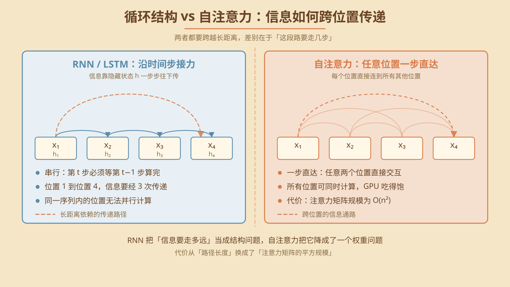
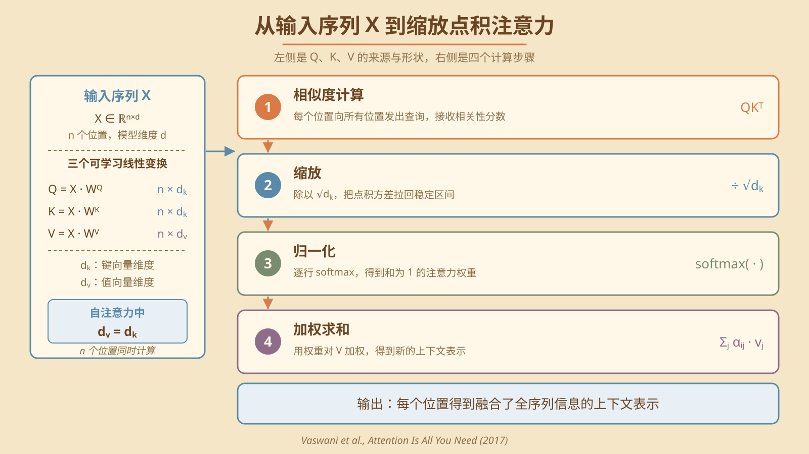
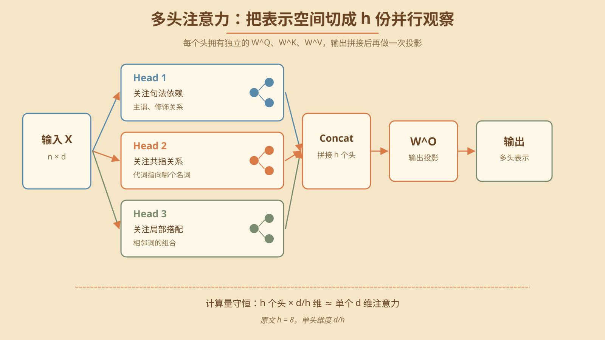
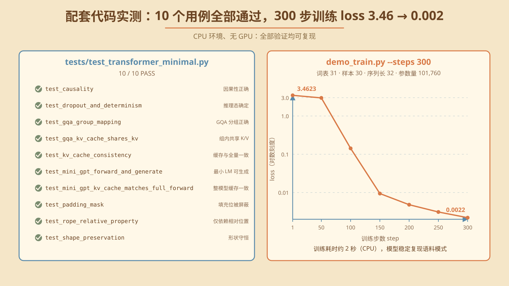
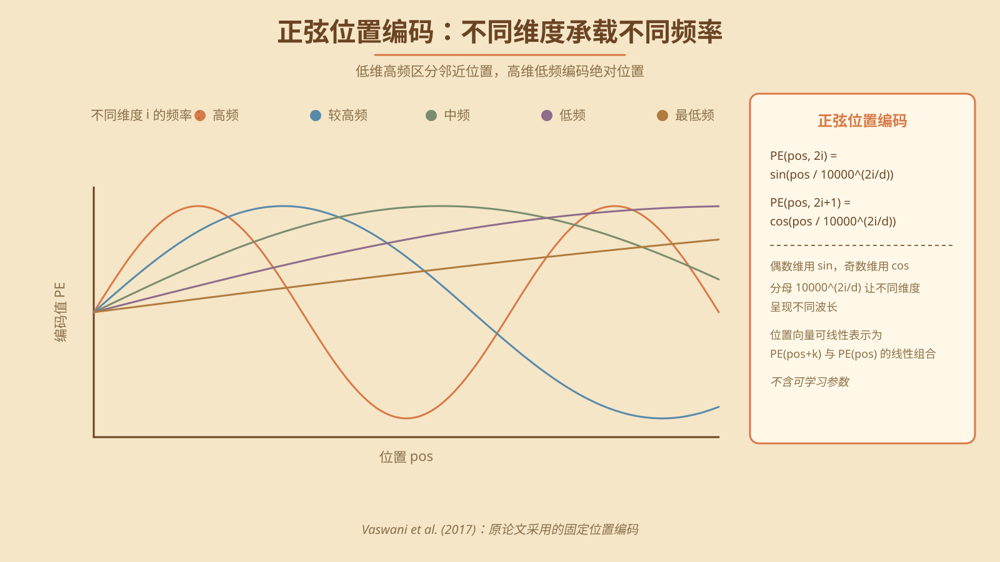
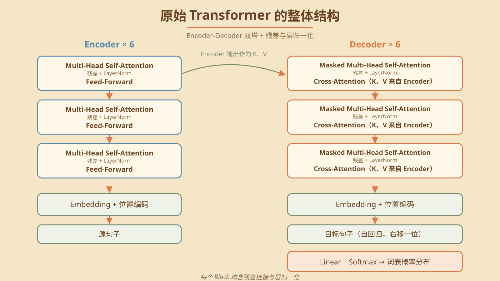
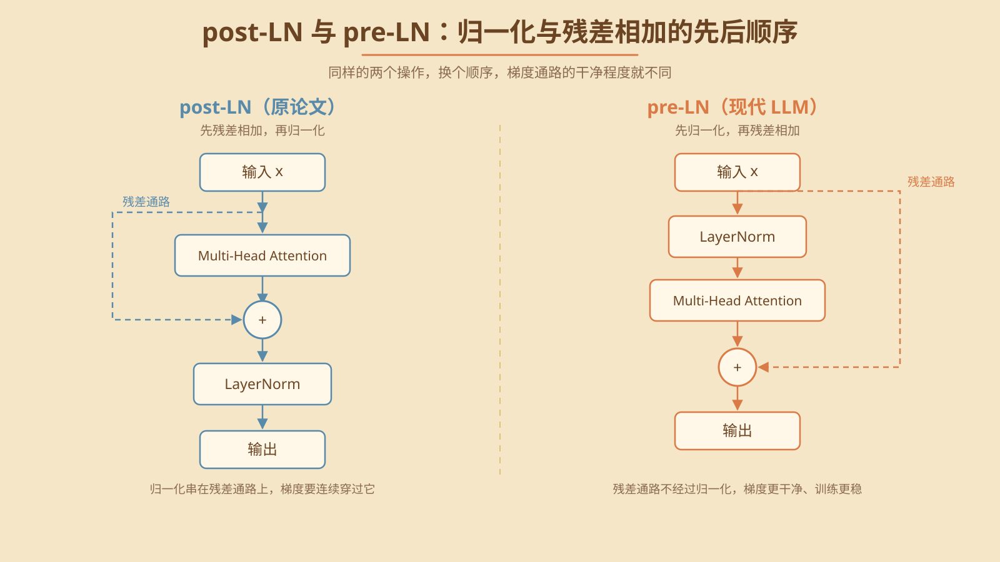
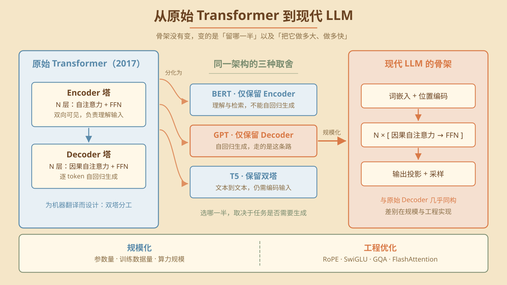

> [!NOTE] 笔记说明
>
> 这篇笔记对应的是《[[关于 AI 的学习路线图]]》一文中所规划的第二个学习阶段，主要讨论深度神经网络的具体实现架构。在该讨论过程中，我会以 Transformer 为例，详细介绍神经网络究竟是如何通过具体的程序结构来处理序列数据的。同样的，这些内容也将成为我 AI 系列笔记的一部分，被存储在本人 Github 上的[计算机学习笔记库](https://github.com/owlman/CS_StudyNotes)中，并予以长期维护。

在同属于第二学习阶段的《[[深度学习的训练与评估]]》那篇笔记中，我们已经介绍过：神经网络的训练本质上是在参数空间 $\Theta$ 中寻找一组参数 $\theta^*$。它的目标是让 $f_{\theta^*}$ 在给定数据分布上足够接近目标函数 $f^*$。但我在那篇笔记中刻意回避了一个至关重要的问题：深度神经网络在计算机程序中具体应该被组织成什么样的结构，才能有效地完成它需要学习的映射关系？换言之，现代主流 LLM 背后的那套基础架构究竟是什么？我们接下来在这篇笔记中要讨论的 **Transformer 架构**，正是这个问题的答案。

关于 Transformer 架构的系统论述，最早出现在 2017 年发表的论文《[Attention Is All You Need](https://arxiv.org/abs/1706.03762)》中。在经过了近十年的发展之后，理解这一架构如今已经成为了研究现代 LLM 一切行为的前提，今天绝大多数主流 LLM 所使用的核心架构，本质上都是 Transformer 或其变体。不理解它，我们就很难真正理解这些 LLM 的内部工作机制，以及此后大多数架构演进。

当然，需要提前说明的是，我在这里并**不打算**从数学的角度详细讨论 Transformer 架构的训练细节，关于这部分内容，可参考我之前在《[[深度学习的训练与评估]]》那篇笔记中的介绍。

这篇笔记的核心任务只有一个：把原始 Transformer 的工作原理讲清楚，并以此为基础理解现代 LLM 的架构演进。换言之，我们在这里也**不打算**逐一展开不同注意力变体（譬如 Flash Attention、Linear Attention 等）的内部实现，MoE 这类稀疏化路线也不在本文的讨论范围内。我们只在接近尾声时给出一张速查对照表，帮助看清它们各自解决了哪一层问题。我们真正要关心的只是 “为什么是这个结构”，而非 “如何高效实现它”。为此，本篇将按照由问题到原理、再到架构和演进的顺序，依次讨论下面这些主题（见表 1）。

| 主题 | 要讨论的内容 |
|---|---|
| 序列建模的历史困境 | RNN/LSTM 在处理长序列时所遇到的具体问题。|
| 自注意力机制的直觉 | 从循环聚合到全连接加权聚合的思路转变。|
| 缩放点积注意力 | 注意力机制的数学形式化定义。|
| 多头注意力 | 如何让 LLM 在不同子空间中实现并行观察。|
| 位置编码 | 没有位置编码就没有顺序感。|
| 整体架构 | 编码器块与解码器块的内部结构，残差连接与层归一化如何协作。|
| 从文本到向量 | 分词与词表、输入嵌入与输出层、参数量与计算量的估算。|
| 延伸思考 | 几个常被问到的 “为什么”：FFN、堆叠方式、因果掩码与 KV Cache。|
| 典型变体 | BERT、GPT、T5 等变体是如何从同一架构分化出来的。|
| 与现代 LLM 的关系 | Decoder-only Transformer 为何成为 LLM 的事实标准，以及各类注意力变体的速查对照。|

**表 1** 这篇笔记要讨论的主题及其内容

## 序列建模的历史困境

在 Transformer 架构出现之前，自然语言处理领域（以下简称 NLP）主流的序列建模工具是**循环神经网络（RNN）**及其改进版**长短时记忆网络（LSTM）**。它们的核心思路非常直观，就是按照输入序列的顺序依次处理，每个元素的处理操作对应着一个**时间步（Time Step）**。

在这里，时间步是一个**抽象的离散索引**，对应序列中的某个元素位置（第 $t$ 个时间步处理第 $t$ 个元素），而不是物理意义上流逝的时间。也正因为如此，后文的状态转移才能被写成 $h_t = f(x_t, h_{t-1})$ 这种与 $t$ 取值无关的形式。

这种结构的核心机制是**让信息沿时间步依次传递，每一步都对历史做一次总结**。第 $t$ 个时间步的计算依赖当前输入，以及此前时间步传递过来的隐藏状态。因此历史信息需要沿时间步逐步传递（$h_t=f(x_t,h_{t-1})$）。这种循环结构与序列数据的时序依赖关系非常契合，即模型按照序列顺序逐步处理输入，并通过隐藏状态将此前的信息传递到后续时间步。然而，正是这种看似自然的信息处理结构，给自然语言的处理带来了以下两个根本性的工程瓶颈。

1. **长距离依赖的丢失**：RNN 在第 $t$ 步计算隐藏状态 $h_t$ 时，会基于上一步的 $h_{t-1}$ 进行如下递归更新：

    $$
    h_t = f(W_h \cdot h_{t-1} + W_x \cdot x_t + b)
    $$

    这意味着，第 1 个时间步的信息需要经过 $t-1$ 次矩阵乘法与激活函数的 “挤压” 才能传递到第 $t$ 步。这里有两个相关但并不等同的问题需要分开看：**信息保留**方面，早期信息在反复的乘法与激活中可能被衰减或放大；**梯度传播**方面，反向传播的梯度同样要沿这条路径连乘，于是容易出现梯度消失与梯度爆炸。前者是表示能力上的限制，后者是优化上的困难——LSTM 通过引入 “门控机制”（输入门、遗忘门、输出门）主要缓解了后者，对前者也只是部分缓解，而两者都没有消除 “信息必须沿路径逐级传播” 的本质约束。

2. **串行计算无法并行**：RNN 的循环结构要求**第 $t$ 步必须等第 $t-1$ 步计算完成**。这意味着无论 GPU 多么强大，单个序列内的时间步无法被并行处理。当序列长度从数百 token 扩展到数万 token 时，训练时间仍会随序列长度线性增长。这一约束使得 RNN/LSTM 在大规模预训练场景下很快失去竞争力。

为了突破上述工程瓶颈，AI 研究者们提出了 “注意力（Attention）” 这个概念，并进行了一些不怎么成功的早期尝试。例如在 2014 年发表的论文（[注意力机制（arXiv 2014 / ICLR 2015）](https://arxiv.org/abs/1409.0473)）中，Dzmitry Bahdanau 等人就曾主张通过在 RNN 中加入注意力机制，让解码器在生成每个词时回看编码器的所有隐藏状态，从而**绕过固定长度向量**。但这种 “注意力机制 + RNN” 的混合结构仍然受制于 RNN 本身，无法彻底摆脱串行约束。

Transformer 架构所带来的革命性突破在于：**它彻底放弃了 RNN 的循环处理结构**，转而通过实现一种名为 “自注意力（Self-Attention）” 的机制直接建立序列中任意两个位置之间的连接。下面，让我们具体来了解一下该架构所基于的数学直觉。



**图 1** 循环结构与自注意力：信息如何跨位置传递

## 自注意力机制的直觉

自注意力的核心思想可以一句话概括：**序列中的每个位置，都应该能够直接访问序列中所有其他位置的信息，而不需要通过中间状态 “接力” 传递**。为了直观地理解这一点，我们可以做一个思想实验，假设现在模型需要处理是一个长度为 $n$ 的输入序列 $[x_1, x_2, \dots, x_n]$，为了赋予该模型具有较长的记忆能力，我们希望它能为输入序列中的任意一个元素 $x_i$ 都生成一个对应的上下文表示 $z_i$，该怎么做呢？

在 RNN 中，$z_i$ 是通过逐步累积 $h_1 \to h_2 \to \dots \to h_i$ 得到的 “压缩摘要”。在隐藏状态维度固定的前提下，这种压缩必然是有损的——早期信息越传越模糊。而自注意力允许我们跳过这种 “接力”，直接通过如下这个计算式来获得 $z_i$：

$$
z_i = \sum_{j=1}^{n} \alpha_{ij} \cdot x_j
$$

在上述计算式中，$\alpha_{ij}$ 是一个**权重系数**，表示位置 $j$ 对位置 $i$ 的重要性（为直观起见，这里暂且先省略值投影矩阵 $V = XW^V$ 的部分，稍后我们会完整展示它的精确形式）。这其中的关键设计是：**所有位置都共享同一组 $x_j$**，但每个位置 $i$ 都根据自己的上下文独立地决定如何加权聚合它们。换言之，自注意力机制把信息聚合的方式从 “沿时间步递归” 换成了 “按权重一次性加权”，这种方式替换带来了以下三个直接的收益。

1. **长距离依赖不再衰减**：因为输入序列中的第 1 个元素可以直接 “看到” 第 $n$ 个位置，中间没有任何乘法挤压。
2. **位置间计算可并行**：输入序列中所有元素的上下文表示 $z_i$ 可以同时计算，不存在串行依赖。
3. **权重可视化**：注意力权重 $\alpha_{ij}$ 反映的是当前这次注意力计算中各输入元素的权重分配情况，我们可以将其当作观察模型信息聚合行为的一个窗口。当然了，它只是计算链路上的一个中间量，模型的最终输出还同时受到 $V$ 投影、输出投影、残差连接、FFN 以及后续网络层的共同影响，因此**不能直接等同于特征重要性或模型决策的因果解释**。

当然，上述前两点收益只是相对于 RNN 来说的。如果从严而论的话，Transformer 架构并没有从根本上消除模型在长距离信息处理上遇到的困难。它只是让任意两个位置之间建立了**一步可达**的通路，把 “信息必须逐级传播” 的结构性障碍降了下来；模型能否真正利用远距离信息，仍取决于训练数据与任务本身。而且**可并行不等于更省算力**：自注意力的计算复杂度是 $O(n^2 d)$，而 RNN 单层的序列计算约为 $O(n d^2)$。序列较短时后者反而更省，序列变长后 $n^2$ 项会迅速成为主导。因此在短文本、流式输入这类场景下，RNN 至今仍有竞争力。

当然，自注意力也带来一个问题：**序列的顺序信息消失了**。因为上面的公式对所有 $j$ 是一视同仁的，$x_1$ 和 $x_n$ 在公式里没有区别。不过，眼下可以先忽略这个问题，因为我们稍后会介绍如何使用 “位置编码” 来解决它。

## 缩放点积注意力

在理解了自注意力机制背后的数学直觉之后，让我们接着来完整展示一下之前那个计算式在 Transformer 架构中的精确形式。该形式最早出自于一篇题为《[Attention Is All You Need](https://arxiv.org/abs/1706.03762)》的著名论文，对应的是其中提出的 **缩放点积注意力（Scaled Dot-Product Attention）**，具体如下。

$$
\text{Attention}(Q, K, V) = \text{softmax}\left(\frac{QK^\top}{\sqrt{d_k}}\right) V
$$

在上述计算式中，$Q$、$K$、$V$ 三个矩阵分别是**查询（Query）**、**键（Key）**和**值（Value）**。它们都是从同一组输入 $X$ 经过以下三个不同的可学习线性变换得到的：

$$
Q = X W^Q,\quad K = X W^K,\quad V = X W^V
$$

其中，$X \in \mathbb{R}^{n \times d}$ 是用于表示输入序列的矩阵，$n$ 为序列长度、$d$ 为模型维度；而 $W^Q, W^K \in \mathbb{R}^{d \times d_k}$ 与 $W^V \in \mathbb{R}^{d \times d_v}$ 则是模型需要学习的参数矩阵，$d_k$ 是 $Q$、$K$ 矩阵的列维度（即 “键向量” 的维度），$d_v$ 是 $V$ 矩阵的列维度（即 “值向量” 的维度）。因此 $Q$、$K$ 的形状是 $n \times d_k$，$V$ 的形状是 $n \times d_v$；自注意力中通常取 $d_v = d_k$，具体如图 2 所示。



**图 2** 从输入序列 $X$ 到 $Q$、$K$、$V$ 的投影，以及缩放点积注意力的四个计算步骤

下面，让我们根据上面这张图来逐步拆解这个计算式的具体语义。

1. **相似度计算 $QK^\top$**：$QK^\top$ 的第 $i$ 行第 $j$ 列元素 $\langle q_i, k_j \rangle$ 表示 “位置 $i$ 的查询向量” 与 “位置 $j$ 的键向量” 之间的点积相似度。这一步相当于**让输入序列中的每个位置向所有位置发出查询，并接收所有元素返回的相关性分数**。为了方便理解，我们可以将这一过程想象成在图书馆找书。首先，我们会写下自己的需求（$q_i$），然后和图书馆所有书的索引标签（$k_j$）一一比对，看哪本书最相关。

2. **缩放 $\frac{1}{\sqrt{d_k}}$**：直接用 $QK^\top$ 作为 softmax 的输入会出现一个问题：在 $q$、$k$ 各分量独立同分布且零均值、单位方差的常见假设下，当 $d_k$ 较大时，点积的方差会随 $d_k$ 线性增长，导致 softmax 的输入值进入极端区间，**梯度变得极小**。除以 $\sqrt{d_k}$ 这一缩放操作正是为了控制点积的方差，使其无论 $d_k$ 多大都保持稳定的分布。这是 Transformer 训练稳定性的关键工程细节之一，**并非可省略的修饰**。

3. **归一化 $\text{softmax}$**：对每一行（即每个查询位置）做 softmax，将相似度分数转换为**权重分布** $\alpha_{ij}$，满足 $\sum_j \alpha_{ij} = 1$。这一步等价于 “把相似度分数解释为概率：位置 $i$ 应该把多大比例的注意力分配给位置 $j$”。

4. **加权求和 $V$**：最后用得到的权重对值矩阵 $V$ 做加权求和，得到每个位置的输出表示：

    $$
    z_i = \sum_{j=1}^{n} \alpha_{ij} \cdot v_j, \qquad Z = \text{Attention}(Q, K, V) \in \mathbb{R}^{n \times d_v}
    $$

    也就是说，在输入序列中，位置 $i$ 的输出向量 $z_i$ 是所有位置的值向量按注意力权重 $\alpha_{ij}$ 线性组合的结果，形状与 $V$ 相同。整个过程可以理解为：**根据相关性分布，把输入序列中所有元素的信息都重新组织了一次**。当然了，我们在这里还需要留意一下维度关系：单头情况下 $Z$ 的形状为 $n \times d_v$，只有在 $d_v = d_k$ 时它才与键向量的维度 $d_k$ 相同。多头情况下，各头的输出先按头维拼接，再由输出投影 $W^O$ 映射回模型维度 $d$。

至此，我们就完成了自注意力的完整计算。值得强调的是，自注意力的所有计算步骤都是**对输入序列内的所有元素同时进行的**，这也是它能够高效利用 GPU 并行性的原因。

## 多头注意力

由于单个缩放点积注意力输出的表示空间是单一的，输入序列中所有元素都共享同一组 $W^Q$、$W^K$、$W^V$。这就意味着，模型会被迫在同一个表示空间里表达所有类型的 “相关性”，例如句法依赖、共指关系、局部上下文等，而这无疑是限制了模型的表达力。为了突破这一限制，Transformer 架构如今大多数都在具体实现中引入了**多头注意力（Multi-Head Attention）**，它在数学上的精确形式如下：

$$
\text{MultiHead}(Q, K, V) = \text{Concat}(\text{head}_1, \dots, \text{head}_h) W^O
$$

$$
\text{head}_i = \text{Attention}(Q W_i^Q, K W_i^K, V W_i^V)
$$

以上两组公式也都出自《[Attention Is All You Need](https://arxiv.org/abs/1706.03762)》的 3.2.2 节 Multi-Head Attention（Vaswani et al., 2017）。其中 $h$ 代表的是注意力的头数（在原始论文中，$h = 8$），而 $W_i^Q$、$W_i^K$、$W_i^V$ 则是每个头**独立**的参数矩阵，$W^O$ 是最终的输出投影矩阵。



**图 3** 多头注意力：把表示空间切成 h 份并行观察

从维度上看，每个头的投影矩阵满足 $W_i^Q, W_i^K, W_i^V \in \mathbb{R}^{d \times d/h}$，因此单个头的输出维度只有 $d/h$。$h$ 个头拼接（Concat）之后总维度重新变回 $d$，再经 $W^O$ 映射到模型维度。

### 多头机制的意义

直觉上，多头机制允许模型在**多个不同的表示子空间**中并行地观察序列中的相关性。例如：

- 有的头对 “句法依赖”（主谓关系、修饰关系）更敏感；
- 有的头对 “共指关系”（代词指向哪个名词）更敏感；
- 有的头更关注 “局部上下文”（相邻词之间的搭配）。

这种分工不需要人为指定，而是在训练中自然形成的。不过上面这组例子只是帮助理解的**近似直觉**：头的功能并不保证彼此互斥或职责固定，同一条语义线索常被多个头共同编码，不同训练轮次得到的分工也不尽相同。interpretability 研究（如针对 BERT 各头功能的分析）确实能观察到部分头呈现 “功能专一化”，但那属于统计意义上的倾向，而不是可以按头号取义的确定性分工。

### 计算代价的不变性

值得注意的是，与使用同样维度的单头注意力相比，多头机制**没有增加总计算量**。单个头的注意力计算复杂度为 $O(n^2 d_k)$（其中 $n$ 为序列长度，$d_k = d/h$ 为单头的键向量维度，$d$ 为模型维度）。而 $h$ 个头的计算复杂度总和为 $O(h \cdot n^2 d_k) = O(n^2 d)$——每个头的维度被相应缩小为 $d/h$，总计算量守恒。这是一种 “以结构换表达力” 的设计选择。

### 最小实现（PyTorch）

把上面的公式翻译成代码，其实只有二十多行。下面这段实现的是 **仅解码器模型（Decoder-only LLM）里最常见的因果掩码多头自注意力**（对应后文图 6 中 Decoder 的第一个子层）：

```python
import math
import torch
import torch.nn as nn


class MultiHeadSelfAttention(nn.Module):
    """因果掩码的多头自注意力，形状约定：X 为 (batch, seq_len, d_model)。

    教学实现：未包含 padding mask / attention dropout / KV cache 等工程项。
    """

    def __init__(self, d_model: int, n_head: int):
        super().__init__()
        assert d_model % n_head == 0, "d_model 必须能被 n_head 整除"
        self.n_head = n_head
        self.d_k = d_model // n_head  # 单头维度 d_k = d_model / h
        self.W_q = nn.Linear(d_model, d_model)
        self.W_k = nn.Linear(d_model, d_model)
        self.W_v = nn.Linear(d_model, d_model)
        self.W_o = nn.Linear(d_model, d_model)

    def forward(self, X: torch.Tensor) -> torch.Tensor:
        B, n, d = X.shape  # (batch, seq_len, d_model)
        # 投影 -> 拆成 h 个头 -> (B, h, n, d_k)
        q = self.W_q(X).view(B, n, self.n_head, self.d_k).transpose(1, 2)
        k = self.W_k(X).view(B, n, self.n_head, self.d_k).transpose(1, 2)
        v = self.W_v(X).view(B, n, self.n_head, self.d_k).transpose(1, 2)

        scores = q @ k.transpose(-2, -1) / math.sqrt(self.d_k)  # (B, h, n, n)
        causal = torch.triu(torch.ones(n, n, dtype=torch.bool, device=X.device), diagonal=1)
        scores = scores.masked_fill(causal, float("-inf"))  # 掩码 M：屏蔽未来位置
        attn = scores.softmax(dim=-1)  # 每行权重和为 1

        out = (attn @ v).transpose(1, 2).contiguous().view(B, n, d)  # 回到 (B, n, d_model)
        return self.W_o(out)
```

这段代码与前面公式的对应关系是逐行可查的。`W_q/W_k/W_v` 对应 $Q = XW^Q$。`q @ k.transpose(-2, -1) / sqrt(d_k)` 对应缩放点积注意力中的 $QK^\top/\sqrt{d_k}$。`masked_fill` 对应掩码矩阵 $M$；`softmax` 对应归一化步骤；`attn @ v` 对应加权求和。最后的 `transpose(...).view(...)` 则把多头的输出拼接回 $n \times d$ 的形状，与后文表 3 中的形状变化一致。

需要特别留意的是 **`view(B, n, h, d_k)` 这一步**：它正是 “多头” 得以并行、又能在计算量上守恒的关键。每个头只负责 $d/h$ 维，$h$ 个头合起来仍然是 $d$ 维，与后文表 2 中 base 模型 $d_k = d_{\text{model}}/h$ 的取法一致（代码里取的是通用的 $d_{\text{model}} // n_{\text{head}}$）。

需要说明的是，这是一份**教学实现**，目的是把公式逐行对应到代码，而不是可以直接用于生产的注意力模块。它省略了若干工程必备项：**Padding Mask**（区分有效 token 与填充位）、**Attention Dropout**、**KV Cache**（自回归推理）。此外，混合精度与算子融合等优化也不在其中。同时它只处理了 “设备一致” 这一基本问题：掩码张量必须与输入张量位于同一设备，否则 `masked_fill` 会报设备不匹配。要补全这些内容，还需要更细的掩码语义与推理时的状态管理，这部分留待《[[LLM 的部署与测试]]》展开。

### 配套代码

在撰写这篇笔记的同时，我也将上面这段对于 transformer 架构的最小实现固化成了一个可运行、可测试的教学项目，保存在了这篇笔记所在目录下的 `examples/transformer_minimal/` 子目录中，以下是这个项目的相关说明：

| 文件 | 内容 |
|---|---|
| `model.py` | 注意力、FFN、RMSNorm、Decoder 块与最小语言模型 `MiniGPT` |
| `demo_train.py` | 端到端演示：在字符级小语料上训练并自回归生成 |
| `tests/test_transformer_minimal.py` | 10 个用例，逐条验证因果性、Padding Mask、KV Cache 一致性、GQA 分组映射、RoPE 相对性质等 |
| `README.md` | 安装运行方式、实现要点与踩坑记录 |

在这个基础上补齐了上文列出的三项工程必备项——**Padding Mask**、**Attention Dropout**、**KV Cache**——并把正文其他章节提到的 **RoPE**、**GQA**、**RMSNorm**、**SwiGLU** 做成了可选开关（`use_rope`、`n_kv_head`、`norm="rms"`、`swiglu=True`）。实测结果：CPU 上约 2 秒完成 300 步训练，loss 从 3.46 降到 0.002，模型能稳定复现语料模式；10 个测试用例全部通过，具体如图 4 所示。



**图 4** 配套代码实测：10 个用例全部通过，300 步训练 loss 3.46 → 0.002

其中几处容易写错、也最值得对照代码细看的地方是：

- **因果掩码的方向**：必须屏蔽 `query_pos < key_pos` 的 “未来位置”，写反会让模型看到未来——训练 loss 照样下降，但生成结果完全错乱；
- **KV Cache 下的位置偏移**：启用缓存后查询位置不再是 `0..n-1`，因果掩码与 RoPE 的位置下标都要用 `total_kv - n` 起的偏移量；
- **GQA 的广播方向**：应把 KV 头复制到查询头（查询头 `i` 用 KV 头 `i // (h/h_kv)`），而不是把组内查询头求和——后者等价于 MQA，语义不同；
- **RoPE 只能对原始 Q/K 施加一次**：对已旋转的张量再次旋转得到的不是位置平移结果。

关于 KV Cache 在推理链路中的实际位置与性能影响，可参见《[[LLM 的部署与测试]]》。

## 位置编码

我们前面提到，自注意力机制有一个先天缺陷：**它对序列中的所有位置一视同仁**。具体来说，无论输入是 $[x_1, x_2, x_3]$ 还是 $[x_3, x_1, x_2]$，自注意力输出的都是同一个集合，只是顺序会随输入的置换而置换。这被称为**置换等变性（permutation equivariance）**。这意味着模型本身不携带任何顺序信息。这显然不符合我们对 “语言” 的直觉——“猫吃鱼” 和 “鱼吃猫” 的语义截然不同。

为了给模型注入**顺序信息**，Transformer 引入了**位置编码（Positional Encoding）**。其核心思想是：**在输入嵌入中加上一个与位置相关的向量**，使每个位置在进入注意力层之前就携带 “我是第几位” 的信号。

### 固定位置编码（原始 Transformer）

原始论文采用的是基于正弦和余弦函数的固定位置编码：

$$
PE_{(pos, 2i)} = \sin\left(\frac{pos}{10000^{2i/d}}\right)
$$

$$
PE_{(pos, 2i+1)} = \cos\left(\frac{pos}{10000^{2i/d}}\right)
$$

其中 $pos$ 是位置索引，$i$ 是维度索引，$d$ 是嵌入维度。分母中的 $10000^{2i/d}$ 使得**不同维度承载不同频率的波形**：低维频率高、波长短，负责区分邻近位置；高维频率低、波长长，负责编码较远处的绝对位置。



**图 5** 正弦位置编码：不同维度承载不同频率

这种设计的两个核心优势是：

1. **从原理上可外推到训练时未见过更长的序列**（论文原文表述为 *we hypothesized that this would allow the model to extrapolate*）：因为正弦函数是连续的，模型在理论上可以平滑地处理比训练序列更长的位置。但学界普遍观察到，这种外推能力在实际训练中相当有限。
2. **不同位置之间的相对关系可由线性组合表示**：根据三角恒等式，$PE_{pos+k}$ 可以写成 $PE_{pos}$ 的线性函数（组合系数只依赖于偏移量 $k$）。

### 可学习位置编码

另一种主流方案是直接把位置编码视为可学习的参数矩阵，每个位置对应一个可训练的向量（如 BERT 至今仍在使用的可学习绝对位置编码）。这种方案简单直接，但**无法外推到训练时未见过更长的序列**。

后来的 [RoPE（旋转式位置编码）](https://arxiv.org/abs/2104.09864) 走了另一条路：它不增加任何参数，而是对 $Q$、$K$ 施加与位置相关的旋转，把**相对位置关系**直接编码进注意力分数之中，这让它成为现代 LLM（LLaMA、Qwen 等）的事实标准。[ALiBi（线性偏置位置编码）](https://arxiv.org/abs/2108.12409) 则代表了另一条通过线性偏置实现长度外推的路线。这一演进留待后续笔记讨论。

## 整体架构

把前面讨论的所有组件拼起来，我们就得到了原始 Transformer 的完整架构。它由 **Encoder** 和 **Decoder** 两部分组成，每部分各包含若干个相同的 “块（Block）”。



**图 6** 原始 Transformer 的整体结构

| 配置项 | 取值 | 说明 |
|---|---|---|
| $N$ | 6 | Encoder / Decoder 各堆叠 6 层|
| $d_{\text{model}}$ | 512 | 模型维度（隐藏层宽度）|
| $h$ | 8 | 注意力头数|
| $d_k = d_v$ | 64 | 单头键 / 值向量维度（$d_{\text{model}} / h$）|
| $d_{\text{ff}}$ | 2048 | 前馈网络隐藏维度（$4 \times d_{\text{model}}$）|
| 训练数据 | WMT 2014 英德 | 约 450 万句对，源端与目标端各约 25000 token|

**表 2** 原始 Transformer 论文中的关键配置（以 base 模型为例）

表 2 沿用原论文的记号，其中 $d_{\text{model}}$ 即本文正文所说的模型维度 $d$，二者指的是同一个量。

### 编码器块

每个编码器块由两个子层组成：

1. **Multi-Head Self-Attention 子层**：输入是上一层输出 $X$，经过多头自注意力后再经过残差连接与层归一化，得到 $X' = \text{LayerNorm}(X + \text{MultiHead}(X))$。
2. **Feed-Forward Network（FFN）子层**：对每个位置独立地施加一个两层的全连接网络，再经过残差连接与层归一化，得到 $X'' = \text{LayerNorm}(X' + \text{FFN}(X'))$。

其中 FFN 通常实现为：

$$
\text{FFN}(x) = \max(0, x W_1 + b_1) W_2 + b_2
$$

即一个 “扩展-压缩” 的两层感知机，隐藏维度通常是模型维度的 4 倍。

### 解码器块

每个解码器块由三个子层组成，比编码器多一个：

1. **Masked Multi-Head Self-Attention**：在自注意力的相似度矩阵上施加一个**下三角掩码**，使位置 $i$ 只能看到 $\leq i$ 的位置。这是为了让 Decoder 在生成任务中保持 “自回归” 特性——生成第 $t$ 个词时不能偷看第 $t+1$ 个之后的词。
2. **Cross-Attention（Encoder-Decoder Attention）**：Query 来自 Decoder 上一层的输出，而 Key 和 Value 来自 Encoder 的最终输出。这一步让 Decoder 在生成每个词时能够 “参考” 输入序列的完整表示。
3. **Feed-Forward Network**：与编码器块中的 FFN 结构相同。

掩码在公式上的体现，是让注意力分数矩阵在进入 softmax 之前额外加上一项掩码矩阵 $M$：

$$
\text{Attention}(Q, K, V) = \text{softmax}\left(\frac{QK^\top}{\sqrt{d_k}} + M\right)V
$$

其中 $M$ 的元素满足 $M_{ij} = 0$（允许关注）或 $M_{ij} = -\infty$（屏蔽），从而使被屏蔽位置的 softmax 权重严格为 $0$。

这里需要特别澄清一个高频混淆点：**原始 Transformer 的 Decoder 块**包含跨注意力（Cross-Attention），它依赖一个外部的 Encoder 输出；而现代 LLM 所说的 “Decoder-only”，虽然沿用了 “Decoder” 这个名字，却只保留因果掩码自注意力与 FFN 两个子层，**没有跨注意力**——因为它根本不存在编码器输出可以参考。后文提到的 GPT、LLaMA、Qwen 都属于后者，与原始翻译系统里的 Decoder 块在结构上并不相同。

掩码在数值上是什么样子，可以直接跑一遍。下面这段代码先造一个随机的分数矩阵，再用下三角掩码屏蔽未来位置，最后做 softmax：

```python
import torch

n = 4
torch.manual_seed(0)
scores = torch.randn(n, n)                                  # 假设的分数矩阵 QK^T / sqrt(d_k)
causal = torch.triu(torch.ones(n, n, dtype=torch.bool), diagonal=1)  # 1 表示屏蔽未来
attn = scores.masked_fill(causal, float("-inf")).softmax(dim=-1)

print(causal.int())
print(attn)
```

输出是：

```text
tensor([[0, 1, 1, 1],
        [0, 0, 1, 1],
        [0, 0, 0, 1],
        [0, 0, 0, 0]], dtype=torch.int32)
tensor([[1.0000, 0.0000, 0.0000, 0.0000],
        [0.5391, 0.4609, 0.0000, 0.0000],
        [0.4478, 0.0917, 0.4604, 0.0000],
        [0.1340, 0.4099, 0.3632, 0.0928]])
```

两点值得注意：第 0 行只允许关注自己，权重自然就是 1.0000；最后一行可以看到全部 4 个位置，权重之和仍然是 1。而所有被屏蔽位置的权重都严格为 0——这正是公式中用 $-\infty$ 而不是某个大负数的原因：取负无穷时 softmax 的指数项直接为 0，梯度也不会从这些位置泄漏回无效位置。

### 残差连接与层归一化的意义

残差连接（$X + \text{Sublayer}(X)$）与层归一化（LayerNorm）的组合并非 Transformer 的发明。但 Transformer 是首批把二者作为 “标配” 应用于深网络结构的架构之一。它们的作用是：

- **缓解深层网络的梯度消失**：残差连接提供了从输入到输出的 “直连通路”，使梯度的反向传播路径得以保留，从而缓解梯度消失。
- **稳定训练过程**：层归一化对每个样本的特征维度做归一化，使各层的输入分布保持稳定，从而允许更大的学习率。

没有这两个机制，今天动辄几十层、上百层的 Transformer 根本无法稳定训练。

这里还有一个容易被忽略的细节。原论文采用的是 **post-LN**（先做残差相加、再做归一化，即上面写出的 $X' = \text{LayerNorm}(X + \text{MultiHead}(X))$）。而现代 LLM（如 LLaMA、Qwen 系列）普遍改用 **pre-LN**（先归一化、再做残差相加），并把 LayerNorm 换成**计算更省的 RMSNorm**（RMSNorm 省去了均值中心化与偏置项，只做均方根缩放，单层开销更小）。



**图 7** post-LN 与 pre-LN：归一化与残差相加的先后顺序

两者的差别只在 “先做哪一步”，但影响不小：post-LN 的残差通路上串联着归一化层，深层堆叠时梯度要连续穿过这些层，训练早期更不稳定，对学习率预热（warmup）的依赖也更明显；pre-LN 把归一化挪到子层之前，残差通路本身成为一条从输入直达输出的 “干净” 梯度通道，训练更稳定、可以少依赖甚至去掉学习率预热——这是深层堆叠能够成立的重要工程前提。现代 LLM 普遍选择 pre-LN，正是出于这层考虑。

## 从文本到向量：分词、嵌入与规模估算

整体架构说明的是 “模型内部长什么样”，但模型真正吃进去的并不是句子，而是一串 token id。这一节补上这条从文本到向量的前置链路，并顺带估算一下这样的模型到底有多大。

### 分词与词表（Tokenizer）

Transformer 面对的原始输入是文本，而模型内部的一切计算都发生在向量上。在两者之间还隔着一步：**分词（Tokenization）**。

分词器把一段文本切分成一串 token，并为每个 token 分配一个词表内的整数 id。现代 LLM 普遍采用**子词（subword）**方案：高频词整体成词，低频词拆成更小的片段，从而在词表大小与序列长度之间取得平衡。三种主流实现可以归为：

- **BPE（Byte Pair Encoding）**（[Sennrich et al., 2016](https://arxiv.org/abs/1508.07909)）：从字节或字符出发，反复合并出现频率最高的相邻符号对。GPT-2 及其后的 OpenAI 系列都基于它。
- **SentencePiece / Unigram**（[Kudo & Richardson, 2018](https://aclanthology.org/D18-2012/)）：把 “子词切分” 建模为一个概率模型，直接学出词表，而不是依赖固定的合并规则。Llama 2 采用 SentencePiece，T5 采用 Unigram。
- **WordPiece**：Google 为 BERT 开发的分词算法，合并规则与 BPE 类似，但以似然准则选择合并对象（算法细节见 [BERT 官方仓库的 Tokenization 说明](https://github.com/google-research/bert/blob/master/README.md#tokenization)；该算法在工程实现层面的分析与优化可参见 [Song et al., 2021](https://aclanthology.org/2021.emnlp-main.160/)）。

Llama 3 起改用 tiktoken 风格的 BPE，词表从 32000 扩到了 128256。

词表大小 $\lvert V \rvert$ 直接决定了三件事：**嵌入表的行数**（$\lvert V \rvert \times d$）、**输出层投影的宽度**（$d \times \lvert V \rvert$），以及**同一段文本被切出的 token 数**。词表越大，序列越短，注意力矩阵的规模越小；但输出端的 softmax 需要在每个位置遍历整个词表，词表过大会直接推高显存占用与推理延迟。实践中的取值大致是：GPT-2 为 50257，Llama 2（[Touvron et al., 2023](https://arxiv.org/abs/2307.09288)）为 32000，Llama 3（[Dubey et al., 2024](https://arxiv.org/abs/2407.21783)）为 128256。

还有一点与中文读者直接相关：**中文的 token 效率高度依赖预训练词表**。同一句中文，切分结果可能是一个 token，也可能被拆成十几个字节级碎片。主流做法是**字节级回退（byte-level fallback）**——保证任何字符都能被表示——代价是罕见字会占用远多于一个 token 的长度。

这个代价有多大，可以实测。用 [tiktoken](https://github.com/openai/tiktoken) 的 `cl100k_base` 词表（GPT-4 与 GPT-3.5 Turbo 使用的 BPE 词表）切几段文本，结果如下：

- `Hello, world!` → 4 个 token；
- `The quick brown fox jumps over the lazy dog.` → 10 个 token；
- `深度学习的训练与评估`（10 个汉字）→ **15 个 token**，比字符数还多；
- `猫 坐在 垫子上`（8 个字符，含两个空格）→ 12 个 token。

差别来自词表对不同语言的覆盖程度：常用英文单词通常已在词表里，而常见汉字往往不在。字节级回退把一个汉字的 UTF-8 编码（3 字节）拆成字节级 token，实测中一个汉字会占 1–3 个 token 不等（`度`、`学`、`的` 等字恰好在词表里，只占 1 个；`猫`、`垫` 则被拆成 3 个），因此 token 数可能**超过**字符数。序列长度 $n$ 又直接决定注意力矩阵的 $n \times n$ 规模，因此词表对中文的覆盖程度，最终会转化为训练与推理成本上的差距——这正是面向中文的模型往往配更大词表、也更依赖字节级词表的原因。

词表版本本身也在改善这一点：把上面那句中文换成较新的 `o200k_base` 词表，token 数从 15 降到 8。中文分词效率的提升最终要靠词表迭代来完成，而不只是靠算法。

有了 token id，才能进入嵌入层，这正是下一节要处理的事情。

### 输入嵌入与输出层

前面讨论的网络内部结构（注意力、FFN、残差与归一化）还缺少最外层的输入与输出：一个完整的 Transformer，还需要先把文本变成向量，再把向量变回词表上的概率。

**输入端**先把离散的 token 变成向量：每个 token 通过查表得到词嵌入，再与位置编码相加，最终得到序列矩阵 $X \in \mathbb{R}^{n \times d}$：

$$
X = \text{Embedding}(x_1, \dots, x_n) + PE
$$

**输出端**（以现代 LLM 普遍采用的 Decoder-only 架构为例）把最后一层的隐状态投影回词表空间，再经 softmax 得到下一个 token 的概率分布：

$$
P(x_{t+1}) = \text{softmax}(H_{\text{final}} W^E + b)
$$

其中 $H_{\text{final}} \in \mathbb{R}^{n \times d}$ 是最后一层的输出，$W^E$ 的形状是 $d \times \lvert V \rvert$（$\lvert V \rvert$ 为词表大小）。实践中常与输入嵌入矩阵共享权重（weight tying）。若输入嵌入表记作 $E \in \mathbb{R}^{\lvert V \rvert \times d}$，则共享时 $W^E = E^\top$，以节省参数量。

| 组件 | 作用 | 输出形状（序列长度 $n$、模型维度 $d$） |
|---|---|---|
| 词嵌入层 | token id → 向量，查表操作 | $n \times d$ |
| 位置编码 | 注入顺序信息，与词嵌入相加 | $n \times d$ |
| 多头自注意力 | 序列内信息聚合 | $n \times d$ |
| 前馈网络 | 逐位置的非线性变换 | $n \times d$ |
| 输出投影 + Softmax | 隐状态 → 词表概率分布 | $n \times \lvert V \rvert$ |

**表 3** 以 Decoder-only 架构为例，各层的数据形状

可以看到，Transformer 内部**从头到尾都保持了 $n \times d$ 的形状**。位置维度 $n$ 只在注意力矩阵 $n \times n$ 的中间步骤里才发生膨胀，这也是后面讨论复杂度瓶颈时的关键。

把上面这张表连起来看一遍会更直观。以一句 “猫 坐在 垫子上” 为例（这里为演示形状，假设一个词就是一个 token，共 3 个）：查表得到 $3 \times d$ 的嵌入矩阵，加上位置编码后进入第一个块；此时 $Q$、$K$、$V$ 各为 $3 \times d$，注意力分数矩阵是 $3 \times 3$，加权聚合后的输出回到 $3 \times d$。

多头拼接后经 $W^O$ 仍回到 $3 \times d$，加上残差、再归一化；FFN 把 $3 \times d$ 扩成 $3 \times 4d$ 再压回 $3 \times d$；如此堆叠 $N$ 层后，最后一层的 $3 \times d$ 经输出投影变成 $3 \times \lvert V \rvert$ 的 logits，取 softmax 后的最后一列，就是 “下一个 token” 的概率分布。整个过程中只有一个地方真正 “变胖”——注意力分数矩阵，而它恰好也是后面复杂度瓶颈的来源。

### 参数量与计算量的估算

结构清楚了之后，一个自然的问题是：这个模型究竟有多大？Transformer 的参数量其实可以闭式估算。

对**单个 Transformer 块**而言：

- **多头注意力**：$Q$、$K$、$V$ 三个投影各为 $d \times d$，加上输出投影 $d \times d$，合计 $4d^2$；
- **前馈网络**：两层全连接，隐藏维度取 $4d$ 时为 $2 \times d \times 4d = 8d^2$；
- 偏置项与 LayerNorm 的 $O(d)$ 参数相对整体可以忽略。

于是每个块约 $12d^2$，堆叠 $N$ 层并加上输入嵌入表与输出投影（未共享权重时），总参数量约为：

$$
N_{\text{params}} \approx 12Nd^2 + 2\lvert V \rvert d
$$

需要说明的是，这是一个**近似模型**：它假设标准的多头注意力与 $4d$ 隐藏维的 FFN，忽略了偏置项、归一化参数，以及 GQA、SwiGLU、RoPE 等具体实现带来的差异。因此它适合用来判断参数量的量级，而不是用来与官方数字精确对账。

以 Llama 2 7B 为例：$d = 4096$、$N = 32$、$\lvert V \rvert = 32000$。代入得 $12 \times 32 \times 4096^2 \approx 6.44 \times 10^9$，加上嵌入与输出层的 $2 \times 32000 \times 4096 \approx 2.6 \times 10^8$，合计约 $6.7 \times 10^9$，与官方公布的 70 亿参数基本吻合。（Llama 2 实际采用 SwiGLU 前馈网络——三个投影矩阵、隐藏维度 11008，因此精确值与上述估算略有出入，但量级完全一致。）

参数量又能换算成算力：**一次前向传播每生成一个 token，约需 $2N_{\text{params}}$ 次浮点运算**；训练时再加上反向传播约为其三倍，即 $6N_{\text{params}}$。这解释了为什么在固定的算力预算下，模型规模与数据量必须反复权衡——算力预算是先于架构设计落地的硬约束。这条换算同样是粗略估计：它把随序列长度二次增长的注意力矩阵计算、词表投影开销与真实硬件利用率都排除在外，实际的训推开销还取决于序列长度、批量大小与并行效率。

## 延伸思考：几个常被问到的 “为什么”

### 为什么 FFN 可以理解为 “逐 Token 的非线性变换”？

FFN 对序列中的每个位置**独立**作用，且所有位置共享同一套参数，因此它等价于把同一个非线性映射施加到序列的每个 Token 上。它与注意力恰好互补：注意力负责**跨位置的信息交换**，FFN 负责**单个位置内部特征的深化**（先扩维再压缩）。FFN 的参数量通常占整个模型的绝大部分。

### 为什么注意力与 FFN 要交替堆叠？

两者做的本来就是两类不同的事——一层负责 “通信”，一层负责 “变换”。交替堆叠意味着每一层都先重新组织跨位置的信息，再对每个位置做非线性加工，使深层表示既携带全局上下文，又有足够的变换深度。标准做法是每层由一个注意力子层与一个 FFN 子层组成，即 1:1 交替；堆叠比例在实践中并不固定，但 1:1 是绝大多数模型的默认选择。

### Decoder-only 架构如何靠因果掩码实现自回归？

下三角掩码保证位置 $i$ 的表示只由 $\leq i$ 的位置决定，因此**训练时**可以一次性并行计算所有位置的 “下一个 Token 预测”。而**推理时**由于必须逐位置生成、天然无法并行，才需要 KV Cache 这类工程手段。换句话说，训练期的并行性恰恰是由掩码的 “严格单向” 所保证的。

### KV Cache 为什么能减少自回归推理中的重复计算？

自回归解码每生成一个 Token，都要把已有前缀重新过一遍注意力：若不使用缓存，第 $t$ 步需要把长度为 $t$ 的前缀整体重算。而前缀各位置的 $K$、$V$ 只取决于已生成的内容，生成之后便不再变化，因此可以把它们缓存下来。每步只为新 Token 计算一次 $K$、$V$，再与缓存的历史位置做一次注意力交互（第 $t$ 步为 $O(td)$，而不是 $O(t^2d)$）。KV Cache 并没有改变注意力的数学形式，它只是把 “重复计算” 换成了 “重复读取”。

两者的差距可以直接用算术估出来。设当前前缀长度 $t = 8$、单头维度 $d = 64$：

```python
t, d = 8, 64

# 无缓存：每一步都要重算前缀中每个位置的 K/V 投影，以及全部两两交互
proj_no_cache = 2 * t * d      # K 与 V 两个投影张量
attn_no_cache = 2 * t * t * d  # QK^T 与 (attn @ V) 两次矩阵乘

# 有缓存：K/V 只在本步为新 token 计算一次，历史部分直接读缓存
proj_with_cache = 2 * d
attn_with_cache = 2 * t * d

print(f"无缓存  投影 {proj_no_cache:5d}  注意力 {attn_no_cache:5d}")
print(f"有缓存  投影 {proj_with_cache:5d}  注意力 {attn_with_cache:5d}")
```

输出是：

```text
无缓存  投影  1024  注意力  8192
有缓存  投影   128  注意力  1024
```

投影开销从随 $t$ 线性增长降为常数，注意力交互从 $t^2$ 降为 $t$。前缀越长、序列越长，这个差距越大。

顺带厘清三个常被混在一起的概念：**RoPE** 解决的是 “位置信息如何进入注意力分数”，**GQA** 解决的是 “缓存里要存几套 $K$、$V$”，**KV Cache** 解决的是 “推理时哪些 $K$、$V$ 可以复用”。三者作用在不同环节，可以同时使用而互不冲突——LLaMA 2 就是 RoPE + GQA + KV Cache 的组合。

## 典型变体

原始 Transformer 是一个 Encoder-Decoder 的对称结构，主要面向机器翻译这类 “输入-输出” 任务。但实际工程中，更常见的做法是根据任务需求**只取 Encoder 或 Decoder 的一部分**。这三种分化催生了现代 NLP 的三大主流架构。

而架构的分化，很大程度上其实是**预训练目标**分化的直接投影：目标决定了模型 “看得到什么” 以及 “要预测什么”，进而决定了注意力的方向性与是否需要跨注意力子层。理解这一点，后面的三种架构就好记了。

### 训练目标：三种自监督学习信号

- **自回归语言建模（causal LM）**：给定前文预测下一个 token，损失为 $-\sum_t \log P(x_t \mid x_{<t})$。由于因果掩码的存在，一次前向传播就能同时得到所有位置的监督信号，训练并行度高；目标与生成任务天然对齐。代价是每个位置只能利用单侧上下文，无法像 MLM 那样获得双向表示。
- **掩码语言建模（MLM）**：随机遮住一部分 token，让模型结合左右上下文补全。BERT 的标准做法是遮住 15% 的 token，其中 80% 换成 `[MASK]`、10% 换成随机 token、10% 保持原样（后两项是为了防止模型只学到 “[MASK] 一定要被还原” 这一捷径）。它只在被遮住的位置上计算损失，且条件里同时含有左右两侧的可见 token，因此能得到双向表示；但预训练时存在的 `[MASK]` 在下游推理中并不存在，形成预训练与微调之间的不一致。
- **Span corruption（跨度破坏）**：遮住连续的一段文本并让模型还原整段，T5 采用这一方案（被遮部分用 `<extra_id_0>` 一类的哨兵 token 标记，遮蔽比例约 15%、平均跨度约 3 个 token）。相比逐 token 的 MLM，它更接近翻译、摘要这类 “整段生成” 的任务形态，同时保留了部分双向信息。

把三种目标的损失函数并排放在一起，差异会更直观。设序列为 $x_1, \dots, x_n$，$\mathcal{M}$ 为被遮住的位置集合、$\mathcal{U}$ 为其余可见位置：

**自回归语言建模**：每个位置都预测下一个 token，

$$
\mathcal{L}_{\text{Causal}} = -\sum_{t=1}^{n} \log P(x_t \mid x_{<t})
$$

**掩码语言建模**：只在被遮住的位置上计算，条件是完整的可见上下文 $\mathcal{U}$（左右两侧都在内），

$$
\mathcal{L}_{\text{MLM}} = -\sum_{i \in \mathcal{M}} \log P(x_i \mid x_{\mathcal{U}})
$$

**Span corruption**：把一段连续 token 折叠成哨兵位置，预测的是整段内容，设哨兵位置集合为 $S$，

$$
\mathcal{L}_{\text{span}} = -\sum_{s \in S} \log P(\text{span}_s \mid x_{\setminus S})
$$

三者的差别可以归纳为两点：**监督信号打在哪里**（自回归是每个位置，MLM 是约 15% 的位置，span corruption 是少量哨兵位置）与 **条件里能看到什么**（自回归只能看过去，MLM 与 span corruption 能看两侧）。前者决定了并行度与数据效率，后者决定了注意力必须是因果的还是双向的——这正是三种目标与三种架构一一对应的原因。

从监督信号密度的角度还可以补一句：在同等算力预算下，自回归目标的数据效率通常更高，而 span corruption 虽然信号密度最低，覆盖的上下文却最长。

三种目标与三种架构的对应关系因此很直接：**MLM 需要双向注意力 → Encoder-only；自回归需要因果掩码与逐 token 采样 → Decoder-only；span corruption 需要 “读懂输入、生成输出” → Encoder-Decoder**。理解这一点，就更容易明白为什么后来的 LLM 几乎都收敛到了 Decoder-only：自回归目标与生成任务对齐，且训练时能一次性并行计算整段序列的损失。

### BERT：仅编码器（Encoder-only）

2018 年 Google 提出的 [BERT（arXiv:1810.04805）](https://arxiv.org/abs/1810.04805) 只使用了 Transformer 的 Encoder 部分。它在预训练阶段引入了两个自监督任务——**掩码语言模型（Masked Language Modeling, MLM）**和**下一句预测（Next Sentence Prediction, NSP）**（MLM 的具体做法见上文 “训练目标” 一节）。

MLM 让模型学会 “双向” 理解上下文（既能看上文也能看下文），但代价是无法直接用于文本生成。BERT 架构特别适合需要 “理解” 的场景——文本分类、问答、命名实体识别、检索排序等。

### GPT：仅解码器（Decoder-only）

2018 年 OpenAI 提出的 [GPT（OpenAI 技术报告）](https://cdn.openai.com/research-covers/language-unsupervised/language_understanding_paper.pdf) 只保留了原始 Transformer 解码器中的**因果掩码自注意力与 FFN 堆叠**，去掉了跨注意力层（没有编码器输出可参考），因此严格说是 “Decoder-only”，而不是原始的编码器-解码器 Decoder。

它以**自回归语言模型**作为预训练目标——即给定前文预测下一个词。这种架构天然适合文本生成，且通过规模化（参数量、数据量、计算量）展现了强大的 “涌现能力”。

从 [GPT-2（Radford et al., 2019）](https://cdn.openai.com/better-language-models/language_models_are_unsupervised_multitask_learners.pdf) 到 GPT-3 再到 GPT-4，从 LLaMA 到 Qwen 再到 DeepSeek，**公开发布**的现代 LLM 几乎都基于 Decoder-only 架构。需要说明的是，Claude、Gemini 等闭源模型的完整架构从未官方公开，业界普遍认为它们同属 Decoder-only 家族，但严格来说这属于合理推断而非已证实的事实。

### T5：编码器-解码器

2019 年 Google 提出的 [T5（JMLR 21(140)）](https://jmlr.org/papers/v21/20-074.html) 保留了完整的编码器-解码器（Encoder-Decoder）结构。它把所有 NLP 任务统一为 “文本到文本” 的转换问题（即使分类任务也输出 “类别名” 作为文本）。这种架构在翻译、摘要等 “输入-输出” 对齐任务上仍有竞争力，但在通用对话场景下不如 Decoder-only 流行。

### 选型直觉

可以粗略地总结：

- **需要理解语义、不需要生成文本** → Encoder-only（如 BERT）；
- **需要生成文本** → Decoder-only（如 GPT、LLaMA）；
- **需要严格的对齐与改写** → Encoder-Decoder（如 T5、原始翻译系统）。

## 与现代 LLM 的关系

不过，原始 Transformer 还留下了一个著名的结构性瓶颈：**自注意力的计算量与显存占用都随序列长度 $n$ 呈平方增长**（注意力矩阵的规模是 $O(n^2)$）。当上下文从 2K 扩展到 128K 时，注意力矩阵的规模会膨胀约 4000 倍，这正是后来 Flash Attention、稀疏注意力、线性注意力等一系列工程与算法改进要解决的问题。



**图 8** 从原始 Transformer 到现代 LLM：骨架未变，变的是规模与工程实现

理解了原始 Transformer 之后，我们就可以看清现代 LLM 的本质：**它们基本上都是 Decoder-only Transformer 的规模化与工程优化版本**。

其中，**规模化**体现在参数量从亿级跃升到千亿乃至万亿级，训练数据从 GB 级跃升到 TB 级。**工程优化**则体现在下面这一系列改进上，它们使得大模型在长上下文推理、低显存训练、高吞吐推理等场景下变得可行：

- [RoPE](https://arxiv.org/abs/2104.09864)（旋转式位置编码）：用与位置相关的旋转矩阵作用于 $Q$、$K$，让注意力分数直接反映相对位置差。它不引入额外参数；但要特别注意，**把位置信息写进 $Q$、$K$ 不等于自动获得任意长度的外推能力**——超出训练长度后的表现还取决于训练时的长度分布，以及插值、缩放等额外技巧（参见上文关于 ALiBi 与长度外推的讨论）。
- [SwiGLU](https://arxiv.org/abs/2002.05202)（门控线性单元）：用门控激活替换前馈网络中的 ReLU，在同等参数下提升表达力。
- [GQA](https://arxiv.org/abs/2305.13245)（分组查询注意力）：把查询头分成若干组，组内共享同一组键值头，在多头注意力（MHA）与多查询注意力（MQA）之间取折中——相对 MHA，推理时需要缓存的 $K$、$V$ 份数更少，显存占用更低、解码速度更快；相对 MQA，则保留了更多的表达能力。
- GQA 的收益要看清楚它省的是哪一部分：例如 8 个查询头分成 2 组、各组共享一套 $K$、$V$ 时，在序列长度、头维与精度相同的前提下，KV Cache 的数据量约为 MHA（8 套 $K$/$V$）的 $1/4$。需要注意的是，这说的是**缓存部分**的开销，并不意味着整个模型的显存占用也降到 $1/4$。
- [Flash Attention](https://arxiv.org/abs/2205.14135)（分块计算）：把注意力矩阵切成小块（tiling）分块计算，并在分块之间重算中间结果，从而避免在显存中物化完整的注意力矩阵；注意力结果在数学上仍是精确的，只是改变了计算与访存的组织方式。
- [FlashAttention-2](https://arxiv.org/abs/2307.08691)（更好的并行与工作划分）：在 FlashAttention 的基础上重新设计线程间的工作划分，减少跨 warp 的通信与同步开销，进一步提升 GPU 利用率；它同样不改变注意力的数学形式，结果仍是精确的。
- 稀疏注意力（[Longformer](https://arxiv.org/abs/2004.05150) / [BigBird](https://arxiv.org/abs/2007.14062) / [NSA](https://arxiv.org/abs/2502.11089)）：只让每个位置连接局部的窗口或稀疏选中的块，把两两交互从 $n^2$ 压到 $nw$ 级别；选中的连接仍是精确计算的。
- 线性注意力（[Performer](https://arxiv.org/abs/2009.14794) / [Linformer](https://arxiv.org/abs/2006.04768)）：前者用核技巧（FAVOR+）近似 softmax 注意力核，后者对 $K$、$V$ 做低秩投影，二者都不再显式物化 $n \times n$ 的注意力矩阵。

Flash Attention 的收益来自对 **IO 复杂度** 的重新分析。设序列长度为 $n$、单个头的维度为 $d_k$、片上 SRAM 容量为 $M$（按元素个数计）。标准注意力必须把 $n \times n$ 的注意力分数矩阵写回 HBM 再读出来，HBM 访问量的下界是 $\Omega(n d_k + n^2)$；FlashAttention 把整个矩阵始终留在 SRAM 内分块复用，只把 $Q$、$K$、$V$ 与输出流式地读入读出，HBM 访问量降为 $O(n^2 d_k^2 / M)$。

论文还给出了一个下界证明：在一定 SRAM 容量区间内，任何精确注意力算法都无法再降低 HBM 访问次数，FlashAttention 在该区间内就是最优的。

这就是它 “不改变数学、只改变访存组织” 却被主流实现广泛采纳的原因——**算得更快这件事本身，很大程度上取决于数据怎么在显存层级之间搬运**。注意表 4 中 Flash Attention 的时间复杂度仍是 $O(n^2 d)$：它优化的是访存而非计算量本身，所以加速幅度取决于具体硬件的显存带宽与算力之比。

前面提到的几条改进路线，其实解决的是不同层面的问题。把它们放进一张表里对照，会更清楚：

| 变体 | 核心思路 | 注意力矩阵 | 时间复杂度 | 显存占用 | 结果是否精确 |
|---|---|---|---|---|---|
| 稠密注意力（原始 Transformer） | 序列内所有位置两两相连 | 完整物化 $n \times n$ | $O(n^2 d)$ | $O(n^2)$ | 精确 |
| Flash Attention | 分块计算 + 块间重算 | 不物化 | $O(n^2 d)$ | $O(n)$ | 精确 |
| 稀疏注意力（Longformer / BigBird / NSA） | 只连接部分位置或块 | 部分物化 | $O(nwd)$ | $O(nw)$ | 对选中的连接精确 |
| 线性注意力（Performer / Linformer） | 用核技巧近似 softmax（Performer），或对 K/V 做低秩投影并保留 softmax（Linformer） | 无需显式矩阵 | $O(nd^2)$（Linformer 为 $O(nkd)$） | $O(nd)$ | Performer 近似；Linformer 在低秩假设下精确 |
| GQA（分组查询注意力） | 查询头分组，组内共享同一套 $K$、$V$ | 完整物化 $n \times n$ | $O(n^2 d)$ | 注意力矩阵 $O(n^2)$；KV Cache 份数降至 MHA 的 $1/g$ | 精确 |

**表 4** 注意力变体的速查对照表

在这张表中，$w$ 为每个位置关注的窗口或块数，$g$ 为 GQA 中查询头的分组数；线性注意力的实际开销还取决于特征映射的维度或低秩投影的秩。从表中应该可以看到两条不同的路线：稀疏注意力与线性注意力改变的是 “算哪些位置”，用更小的连接规模或更省内存的计算方式摆脱了 $n^2$ 的限制，代价主要在表达能力上（Performer 的核近似还会带来精度损失，而 Linformer 只是对 $K$、$V$ 施加低秩投影，在该假设下仍是精确计算）；Flash Attention 改变的是 “怎么算”，它并不减少需要关注的连接，只是通过分块与重算把同样的精确计算做得更省显存、更快。两条路线并不互斥，现代模型常常同时采用。

GQA 则属于另一个维度：它既不改变注意力矩阵本身，也不改变连接关系，只是通过组内共享 $K$、$V$ 减少 KV Cache 的份数（详见上文关于 GQA 的讨论）。

但**所有这些演进都没有改变 Decoder-only Transformer 的核心骨架**——自注意力 + 前馈网络 + 残差归一化 + 自回归语言模型。这意味着，掌握了原始 Transformer 的工作原理，就具备了阅读后续所有 LLM 相关文献的 “地基”。

这里还有一个常被忽略的前提：把这条路线一路推到 AGI，光靠扩大规模与优化工程是不够的。这类模型归根结底是 **基于描述** 的系统——它们的知识来自对已有数据的统计描述，而缺少与客观世界之间自主、连续、可验证的交互闭环。这一结构性限制属于行为主义路线所讨论的问题，具体论证见《[[AI 研究方法的演变]]》。（需要说明：这一判断属于作者在方法论层面的进一步推论，并非从 Transformer 架构本身可以直接得出的结论。）

## 结束语

回到学习路线图的坐标系中，这篇笔记承担的是**架构视角**的入门任务。在《[[深度学习的训练与评估]]》中，我们了解了 “训练侧”——如何把数据转换为参数；而本篇则补充了 “架构侧”——Transformer 这个特定架构是如何组织参数、又是如何处理序列数据的。两篇合在一起，就构成了理解现代 LLM 的最小知识单元。

接下来，按照路线图的规划，第三阶段的笔记（如《[[LLM 的部署与测试]]》《[[LLM 的微调实验]]》）会把视角从 “架构 + 训练” 切换到 “系统 + 角色”。它们会观察 LLM 在 AI 系统中是如何被集成的，以及在不同约束下又会表现出什么样的边界。这是更偏向工程实践的内容，需要建立在架构理解之上——这正是我们花两篇笔记打地基的原因。

## 参考资料

- Vaswani, A., Shazeer, N., Parmar, N., Uszkoreit, J., Jones, L., Gomez, A. N., Kaiser, Ł., & Polosukhin, I. (2017). *Attention Is All You Need*. NeurIPS 2017 / arXiv:1706.03762. <https://arxiv.org/abs/1706.03762>（DOI: 10.48550/arXiv.1706.03762）
- Bahdanau, D., Cho, K., & Bengio, Y. (2015). *Neural Machine Translation by Jointly Learning to Align and Translate*. ICLR 2015 / arXiv:1409.0473. <https://arxiv.org/abs/1409.0473>（DOI: 10.48550/arXiv.1409.0473）
- Devlin, J., Chang, M. W., Lee, K., & Toutanova, K. (2019). *BERT: Pre-training of Deep Bidirectional Transformers for Language Understanding*. NAACL 2019 / arXiv:1810.04805. <https://arxiv.org/abs/1810.04805>（DOI: 10.18653/v1/N19-1423）
- Radford, A., Narasimhan, K., Salimans, T., & Sutskever, I. (2018). *Improving Language Understanding by Generative Pre-Training*. OpenAI Technical Report. <https://cdn.openai.com/research-covers/language-unsupervised/language_understanding_paper.pdf>
- Raffel, C., Shazeer, N., Roberts, A., Lee, K., Narang, S., Matena, M., Zhou, Y., Li, W., & Liu, P. J. (2020). *Exploring the Limits of Transfer Learning with a Unified Text-to-Text Transformer*. JMLR 21(140) / arXiv:1910.10683. <https://arxiv.org/abs/1910.10683>（正式版：<https://jmlr.org/papers/v21/20-074.html>）（DOI: 10.48550/arXiv.1910.10683；JMLR 版无 DOI）
- Su, J., Lu, Y., Pan, S., Murtadha, A., Wen, B., & Liu, Y. (2021). *RoFormer: Enhanced Transformer with Rotary Position Embedding*. arXiv:2104.09864. <https://arxiv.org/abs/2104.09864>（DOI: 10.48550/arXiv.2104.09864；期刊版 Neurocomputing 2024, DOI: 10.1016/j.neucom.2023.127063）
- Press, O., Smith, N. A., & Lewis, M. (2022). *Train Short, Test Long: Attention with Linear Biases Enables Input Length Extrapolation* (ALiBi). ICLR 2022 / arXiv:2108.12409. <https://arxiv.org/abs/2108.12409>（DOI: 10.48550/arXiv.2108.12409）
- Shazeer, N. (2020). *GLU Variants Improve Transformer* (SwiGLU). arXiv:2002.05202. <https://arxiv.org/abs/2002.05202>（DOI: 10.48550/arXiv.2002.05202）
- Ainslie, J., Lee-Thorp, J., de Jong, M., et al. (2023). *GQA: Training Generalized Multi-Query Transformer Models from Multi-Head Checkpoints*. EMNLP 2023 / arXiv:2305.13245. <https://arxiv.org/abs/2305.13245>（DOI: 10.18653/v1/2023.emnlp-main.298）
- Dao, T., Fu, D. Y., Ermon, S., Rudra, A., & Ré, C. (2022). *FlashAttention: Fast and Memory-Efficient Exact Attention with IO-Awareness*. NeurIPS 2022 / arXiv:2205.14135. <https://arxiv.org/abs/2205.14135>（DOI: 10.52202/068431-1189）
- Sennrich, R., Haddow, B., & Birch, A. (2016). *Neural Machine Translation of Rare Words with Subword Units*. ACL 2016 / arXiv:1508.07909. <https://arxiv.org/abs/1508.07909>（DOI: 10.18653/v1/P16-1162）
- Google Research. *BERT: Tokenization*. BERT 官方仓库文档（WordPiece 分词算法的权威说明）. <https://github.com/google-research/bert/blob/master/README.md#tokenization>
- Song, X., Salcianu, A., Song, Y., Dopson, D., & Zhou, D. (2021). *Fast WordPiece Tokenization*. EMNLP 2021 / arXiv:2012.15524. <https://aclanthology.org/2021.emnlp-main.160/>（预印本：<https://arxiv.org/abs/2012.15524>）（DOI: 10.18653/v1/2021.emnlp-main.160；预印本 DOI: 10.48550/arXiv.2012.15524）
- Kudo, T., & Richardson, J. (2018). *SentencePiece: A Simple and Language Independent Subword Tokenizer and Detokenizer for Neural Text Processing*. EMNLP 2018 System Demonstrations / <https://aclanthology.org/D18-2012/>（DOI: 10.18653/v1/D18-2012）
- Radford, A., et al. (2019). *Language Models are Unsupervised Multitask Learners*. OpenAI Technical Report. <https://cdn.openai.com/better-language-models/language_models_are_unsupervised_multitask_learners.pdf>
- OpenAI. *tiktoken*. GitHub 官方仓库（字节级 BPE 分词器的参考实现，本文分词粒度实测数据即由它产出）. <https://github.com/openai/tiktoken>
- Beltagy, I., Peters, M. E., & Cohan, A. (2020). *Longformer: The Long-Document Transformer*. arXiv:2004.05150. <https://arxiv.org/abs/2004.05150>（DOI: 10.48550/arXiv.2004.05150）
- Zaheer, M., et al. (2020). *Big Bird: Transformers for Longer Sequences*. NeurIPS 2020 / arXiv:2007.14062. <https://arxiv.org/abs/2007.14062>（DOI: 10.48550/arXiv.2007.14062）
- Choromanski, K., Likhosherstov, V., Dohan, D., Song, X., Gane, A., & Sarlos, T. (2020). *Rethinking Attention with Performers*. ICLR 2021 / arXiv:2009.14794. <https://arxiv.org/abs/2009.14794>（DOI: 10.48550/arXiv.2009.14794）
- Wang, S., Li, B. Z., Khabsa, M., Fang, H., & Ma, H. (2020). *Linformer: Self-Attention with Linear Complexity*. arXiv:2006.04768. <https://arxiv.org/abs/2006.04768>（DOI: 10.48550/arXiv.2006.04768）
- Dao, T. (2023). *FlashAttention-2: Faster Attention with Better Parallelism and Work Partitioning*. arXiv:2307.08691. <https://arxiv.org/abs/2307.08691>（DOI: 10.48550/arXiv.2307.08691）
- Touvron, H., et al. (2023). *Llama 2: Open Foundation and Fine-Tuned Chat Models*. arXiv:2307.09288. <https://arxiv.org/abs/2307.09288>（DOI: 10.48550/arXiv.2307.09288）
- Dubey, S., et al. (2024). *The Llama 3 Herd of Models*. arXiv:2407.21783. <https://arxiv.org/abs/2407.21783>（DOI: 10.48550/arXiv.2407.21783）
- Yuan, J., Gao, H., Dai, D., et al. (2025). *Native Sparse Attention: Hardware-Aligned and Natively Trainable Sparse Attention*. arXiv:2502.11089. <https://arxiv.org/abs/2502.11089>（DOI: 10.48550/arXiv.2502.11089）
