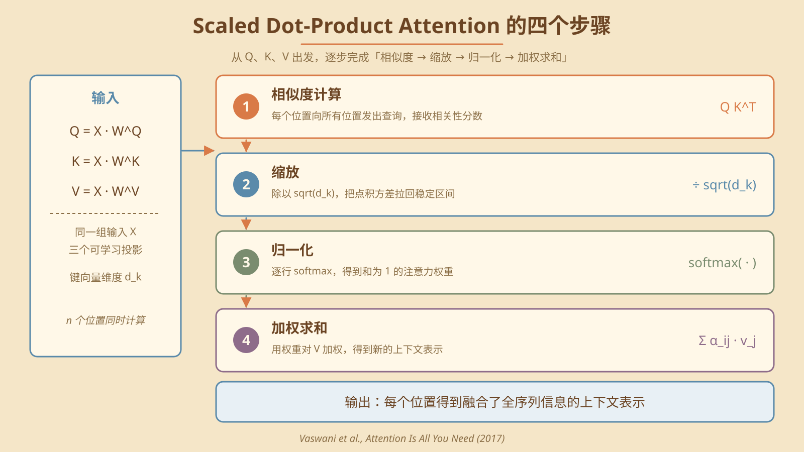
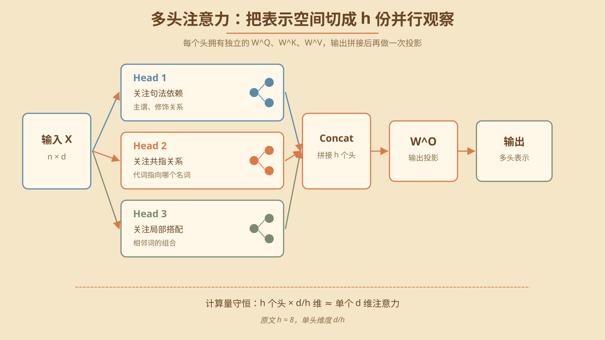
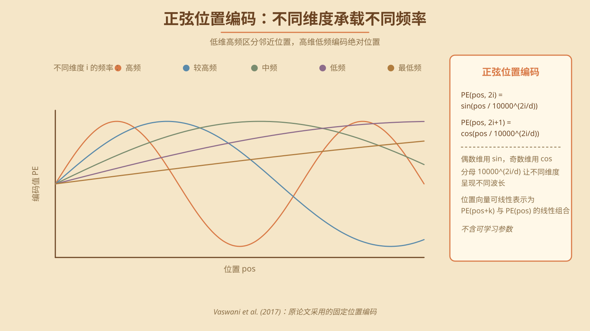
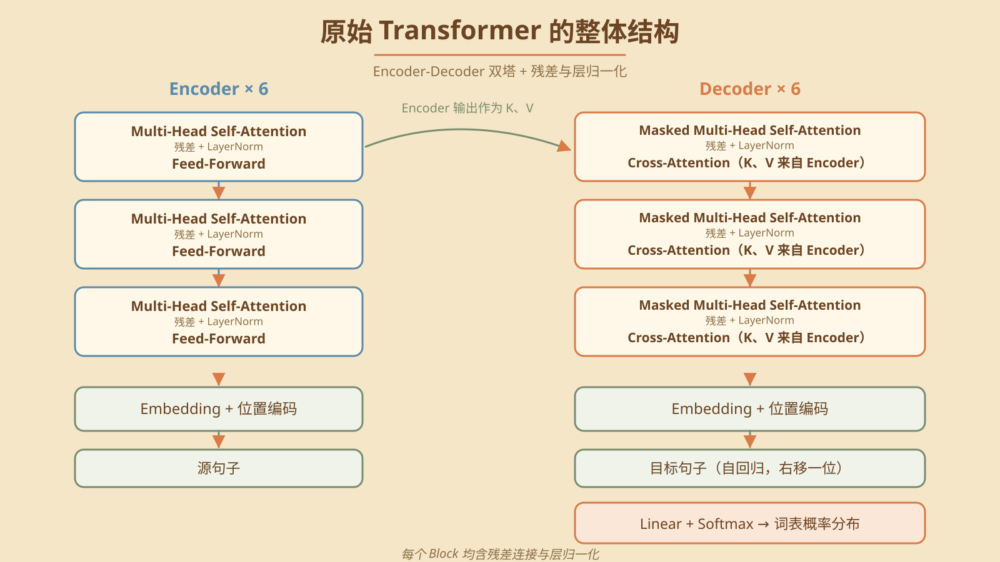

> [!NOTE] 笔记说明
>
> 这篇笔记对应的是《[[关于 AI 的学习路线图]]》一文中所规划的第二个学习阶段，主要讨论深度神经网络的具体实现架构。在该讨论过程中，我会以 Transformer 为例，详细介绍神经网络究竟是如何通过具体的程序结构来处理序列数据的。同样的，这些内容也将成为我 AI 系列笔记的一部分，被存储在本人 Github 上的[计算机学习笔记库](https://github.com/owlman/CS_StudyNotes)中，并予以长期维护。

在同属于第二学习阶段的《[[深度学习的训练与评估]]》那篇笔记中，读者已经了解到：神经网络的训练本质上是在参数空间 $\Theta$ 中寻找一组参数 $\theta^*$。它的目标是让 $f_{\theta^*}$ 在给定数据分布上足够接近目标函数 $f^*$。但我当时刻意回避了一个至关重要的问题：一个神经网络在计算机程序中具体应该被组织成什么样的结构，才能有效地完成它需要学习的映射关系？换言之，现代主流大语言模型（以下简称 LLM）背后的那套基础架构究竟是什么？这篇笔记要讨论的 **Transformer 架构**，正是这个问题的答案。

关于 Transformer 架构的系统论述，最早出现在 2017 年发表的论文《[Attention Is All You Need](https://arxiv.org/abs/1706.03762)》中，这也是本笔记的主要参考来源。经过了这些年的发展，理解这一架构如今已经成为了研究现代 LLM 一切行为的前提。今天绝大多数主流 LLM 的核心网络架构，都是建立在 Transformer 或其变体之上的；不理解它，我们就很难真正理解现代 LLM 的内部工作机制，以及此后大多数架构演进。

当然，需要提前说明的是，我在这里并**不打算**详细讨论 Transformer 的数学训练细节，关于这部分内容，读者可参考《[[深度学习的训练与评估]]》那篇笔记中的介绍。同样的，我也**不打算**逐个比较不同的注意力变体（譬如 Flash Attention、Linear Attention、MoE 等）。

这篇笔记的核心任务只有一个：把原始 Transformer 的工作原理讲清楚，并以此为基础理解现代 LLM 的架构演进。换言之，我们接下来要关心的是 “为什么是这个结构”，而不是 “如何训练它” 或 “如何高效实现它”。为此，我们将按照由问题到原理、再到架构和演进的顺序，依次讨论下面这些主题（见表 1）。

| 主题               | 要讨论的内容                                       |
| ------------------ | -------------------------------------------------- |
| 序列建模的历史困境 | RNN/LSTM 在处理长序列时所遇到的具体问题。          |
| 自注意力的直觉     | 从循环聚合到全连接加权聚合的思路转变。             |
| 缩放点积注意力     | 注意力机制的数学形式化定义。                       |
| 多头注意力         | 如何让 LLM 在不同子空间中实现并行观察。            |
| 位置编码           | 没有位置编码就没有顺序感。                         |
| 整体架构           | 编码器、解码器、残差连接与层归一化的协作。         |
| 典型变体           | BERT、GPT、T5 等变体是如何从同一架构分化出来的。   |
| 与现代 LLM 的关系  | Decoder-only Transformer 为何成为 LLM 的事实标准。 |

**表 1** 这篇笔记要讨论的主题及其内容

## 序列建模的历史困境

在 Transformer 架构出现之前，自然语言处理领域（以下简称 NLP）主流的序列建模工具是**循环神经网络（RNN）**及其改进版**长短时记忆网络（LSTM）**。它们的核心思路非常直观，就是按照序列中的位置依次处理每个元素，每处理一个元素，就对应一个**时间步（Time Step）**。在这里，时间步是一个**抽象的离散索引**，对应序列中的一个位置（第 $t$ 个时间步处理第 $t$ 个元素），而不是物理意义上流逝的时间。也正因为如此，后文的状态转移才能写成 $h_t = f(x_t, h_{t-1})$ 这种与 $t$ 取值无关的形式。

这种结构的核心机制是**让信息沿时间步依次传递，每一步都对历史做一次总结**。第 $t$ 个时间步的计算依赖当前输入，以及此前时间步传递过来的隐藏状态。因此历史信息需要沿时间步逐步传递（$h_t=f(x_t,h_{t-1})$）。这种循环结构与序列数据的时序依赖关系非常契合——模型按照序列顺序逐步处理输入，并通过隐藏状态将此前的信息传递到后续时间步。

但正是这种看似自然的信息处理结构，给自然语言的处理带来了三个根本性的工程瓶颈。

### 长距离依赖丢失

RNN 在第 $t$ 步计算隐藏状态 $h_t$ 时，会基于上一步的 $h_{t-1}$ 进行递归更新：

$$
h_t = f(W_h \cdot h_{t-1} + W_x \cdot x_t + b)
$$

这意味着第 1 个时间步的信息需要经过 $t-1$ 次矩阵乘法与激活函数的“挤压”才能传递到第 $t$ 步。当序列长度较大时，**早期信息会在反复的乘法与激活中被反复衰减或放大**——梯度消失与梯度爆炸正是这一过程的两个极端表现。LSTM 通过引入“门控机制”（输入门、遗忘门、输出门）部分缓解了这一问题，但仍未能从根本上解决“信息必须沿路径传播”的本质约束。

### 串行计算无法并行

RNN 的循环结构要求**第 $t$ 步必须等第 $t-1$ 步计算完成**。这意味着无论 GPU 多么强大，单个序列内的时间步无法被并行处理。当训练数据从几百个词扩展到几万个词时，训练时间会随序列长度线性增长。这一约束使得 RNN/LSTM 在大规模预训练场景下很快失去竞争力。

### 注意力机制的早期尝试

在 Transformer 之前，已经有工作尝试将“注意力”引入 RNN。例如 Bahdanau 等人 2014 年提出的 [注意力机制（arXiv 2014 / ICLR 2015）](https://arxiv.org/abs/1409.0473)。它允许解码器在生成每个词时回看编码器的所有隐藏状态，从而**绕过固定长度向量**的瓶颈。但这种“注意力 + RNN”的混合结构仍然受制于 RNN 本身，无法彻底摆脱串行约束。

Transformer 的革命性在于：**它把循环结构彻底删掉了**，转而用一种名为“自注意力（Self-Attention）”的机制直接建立序列中任意两个位置之间的连接。下面，我们就要来理解这一替换的数学直觉。

## 自注意力的直觉

自注意力的核心思想可以一句话概括：**序列中的每个位置，都应该能够直接访问序列中所有其他位置的信息，而不需要通过中间状态“接力”传递**。

为了直观地理解这一点，我们可以做一个思想实验。假设我们有一个长度为 $n$ 的序列 $[x_1, x_2, \dots, x_n]$，我们希望为其中任意一个位置 $x_i$ 生成一个“上下文表示” $z_i$。在 RNN 中，$z_i$ 是通过逐步累积 $h_1 \to h_2 \to \dots \to h_i$ 得到的“压缩摘要”。这种压缩是有损的——早期信息越传越模糊。

而自注意力允许我们跳过这种“接力”，直接计算 $z_i$：

$$
z_i = \sum_{j=1}^{n} \alpha_{ij} \cdot x_j
$$

其中 $\alpha_{ij}$ 是一个**权重系数**，表示位置 $j$ 对位置 $i$ 的重要性（为直观起见，这里省略了值投影矩阵 $V = XW^V$，其精确形式见后文公式）。这里的关键设计是：**所有位置都共享同一组 $x_j$**，但每个位置 $i$ 都根据自己的上下文独立地决定如何加权聚合它们。换言之，自注意力把“信息聚合”的方式从“沿时间步递归”换成了“按权重一次性加权”。

这种替换带来了三个直接好处：

1. **长距离依赖不再衰减**：因为第 1 个位置可以直接“看到”第 $n$ 个位置，中间没有任何乘法挤压。
2. **位置间计算可并行**：所有 $z_i$ 可以同时计算，不存在串行依赖。
3. **权重可视化**：注意力权重 $\alpha_{ij}$ 反映了当前这次注意力计算中各位置的权重分配情况，可以作为观察模型信息聚合行为的一个窗口。但要留意，它只是计算链路上的一个中间量——最终输出还同时受到 $V$ 投影、输出投影、残差连接、FFN 以及后续网络层的共同影响，因此**不能直接等同于特征重要性或模型决策的因果解释**。

不过，这两点收益都要打上折扣。Transformer 并没有从根本上消除长距离信息处理的困难。它只是让任意两个位置之间建立了**一步可达**的通路，把“信息必须逐级传播”的结构性障碍降了下来；模型能否真正利用远距离信息，仍取决于训练数据与任务本身。而且**可并行不等于更省算力**：自注意力的计算复杂度是 $O(n^2 d)$，而 RNN 单层的序列计算约为 $O(n d^2)$。序列较短时后者反而更省，序列变长后 $n^2$ 项会迅速成为主导。因此在短文本、流式输入这类场景下，RNN 至今仍有竞争力。

当然，自注意力也带来一个问题：**序列的顺序信息消失了**。因为上面的公式对所有 $j$ 是一视同仁的，$x_1$ 和 $x_n$ 在公式里没有区别。我们稍后会用“位置编码”解决这一问题。

## 缩放点积注意力（Scaled Dot-Product Attention）

在理解了自注意力的直觉之后，我们来看它在 Transformer 中的精确数学形式。这就是论文《Attention Is All You Need》中提出的 **缩放点积注意力（Scaled Dot-Product Attention）**：

$$
\text{Attention}(Q, K, V) = \text{softmax}\left(\frac{QK^\top}{\sqrt{d_k}}\right) V
$$

这里的 $Q$、$K$、$V$ 三个矩阵分别是**查询（Query）**、**键（Key）**和**值（Value）**。它们都是从同一组输入 $X$ 经过三个不同的可学习线性变换得到的：

$$
Q = X W^Q,\quad K = X W^K,\quad V = X W^V
$$

其中 $X \in \mathbb{R}^{n \times d}$ 是输入序列矩阵，$n$ 为序列长度、$d$ 为模型维度。$W^Q, W^K \in \mathbb{R}^{d \times d_k}$ 与 $W^V \in \mathbb{R}^{d \times d_v}$ 是模型需要学习的参数矩阵。其中 $d_k$ 是 $Q$、$K$ 矩阵的列维度（即“键向量”的维度），$d_v$ 是 $V$ 矩阵的列维度（即“值向量”的维度）。因此 $Q$、$K$ 的形状是 $n \times d_k$，$V$ 的形状是 $n \times d_v$；自注意力中通常取 $d_v = d_k$。

下面我们逐步拆解这个公式的语义。

### 第一步：相似度计算 $QK^\top$

$QK^\top$ 的第 $i$ 行第 $j$ 列元素 $\langle q_i, k_j \rangle$ 表示“位置 $i$ 的查询向量”与“位置 $j$ 的键向量”之间的点积相似度。这一步相当于**让每个位置向所有位置发出查询，并接收所有位置返回的相关性分数**。

直觉上可以理解为：在图书馆找书时，你写下你的需求（$q_i$），然后和图书馆所有书的索引标签（$k_j$）一一比对，看哪本书最相关。

### 第二步：缩放 $\frac{1}{\sqrt{d_k}}$

直接用 $QK^\top$ 作为 softmax 的输入会出现一个问题：当 $d_k$ 较大时，点积的方差会随 $d_k$ 线性增长，导致 softmax 的输入值进入极端区间，**梯度变得极小**。除以 $\sqrt{d_k}$ 这一缩放操作正是为了控制点积的方差，使其无论 $d_k$ 多大都保持稳定的分布。这是 Transformer 训练稳定性的关键工程细节之一，**并非可省略的修饰**。

### 第三步：归一化 $\text{softmax}$

对每一行（即每个查询位置）做 softmax，将相似度分数转换为**权重分布** $\alpha_{ij}$，满足 $\sum_j \alpha_{ij} = 1$。这一步等价于“把相似度分数解释为概率：位置 $i$ 应该把多大比例的注意力分配给位置 $j$”。

### 第四步：加权求和 $V$

最后用得到的权重对值矩阵 $V$ 做加权求和，得到每个位置的输出表示：

$$
z_i = \sum_{j=1}^{n} \alpha_{ij} \cdot v_j, \qquad Z = \text{Attention}(Q, K, V) \in \mathbb{R}^{n \times d_v}
$$

也就是说，位置 $i$ 的输出向量 $z_i$ 是所有位置的值向量按注意力权重 $\alpha_{ij}$ 线性组合的结果，形状与 $V$ 相同。整个过程可以理解为：**根据相关性分布，把所有位置的信息重新组织一次**。

这里需要留意维度关系：单头情况下 $Z$ 的形状与 $V$ 相同（即 $n \times d_v$），只有在 $d_v = d_k$ 时它才与键向量的维度 $d_k$ 相同。多头情况下，各头的输出先按头维拼接，再由输出投影 $W^O$ 映射回模型维度 $d$。

至此，我们就完成了自注意力的完整计算。值得强调的是，自注意力的所有计算步骤都是**对序列内所有位置同时进行的**——这就是它能够高效利用 GPU 并行性的原因。



**图 1** 缩放点积注意力的四个计算步骤

## 多头注意力（Multi-Head Attention）

单个缩放点积注意力输出的表示空间是单一的——所有位置都共享同一组 $W^Q$、$W^K$、$W^V$。这会带来一个限制：模型被迫在同一个表示空间里表达所有类型的“相关性”。

为了突破这一限制，Transformer 引入了**多头注意力（Multi-Head Attention）**：

$$
\text{MultiHead}(Q, K, V) = \text{Concat}(\text{head}_1, \dots, \text{head}_h) W^O
$$

$$
\text{head}_i = \text{Attention}(Q W_i^Q, K W_i^K, V W_i^V)
$$

其中 $h$ 是头数（原始论文中 $h = 8$），$W_i^Q$、$W_i^K$、$W_i^V$ 是每个头**独立**的参数矩阵，$W^O$ 是最终的输出投影矩阵。



**图 2** 多头注意力：把表示空间切成 h 份并行观察

从维度上看，每个头的投影矩阵满足 $W_i^Q, W_i^K, W_i^V \in \mathbb{R}^{d \times d/h}$，因此单个头的输出维度只有 $d/h$。$h$ 个头拼接（Concat）之后总维度重新变回 $d$，再经 $W^O$ 映射到模型维度。

### 多头的语义

直觉上，多头机制允许模型在**多个不同的表示子空间**中并行地观察序列中的相关性。例如：

- 某个头可能专门关注“句法依赖”（主谓关系、修饰关系）；
- 某个头可能专门关注“共指关系”（代词指向哪个名词）；
- 某个头可能专门关注“局部上下文”（相邻词之间的搭配）。

这种分工并不需要人为指定，而是通过训练自然涌现的。这也是为什么后续的 interpretability 研究（如 BERTology）能够从训练好的 Transformer 中识别出“功能专一化”的头。

### 计算代价的不变性

值得注意的是，与使用同样维度的单头注意力相比，多头机制**没有增加总计算量**。单个头的注意力计算复杂度为 $O(n^2 d_k)$（其中 $n$ 为序列长度，$d_k = d/h$ 为单头的键向量维度，$d$ 为模型维度）。而 $h$ 个头的计算复杂度总和为 $O(h \cdot n^2 d_k) = O(n^2 d)$——每个头的维度被相应缩小为 $d/h$，总计算量守恒。这是一种“以结构换表达力”的设计选择。

### 最小实现（PyTorch）

把上面的公式翻译成代码，其实只有十几行。下面这段实现的是 **Decoder-only LLM 里最常见的因果掩码多头自注意力**（对应图 4 中 Decoder 的第一个子层）：

```python
import math
import torch
import torch.nn as nn


class MultiHeadSelfAttention(nn.Module):
    """因果掩码的多头自注意力，形状约定：X 为 (batch, seq_len, d_model)。

    教学实现：未包含 padding mask / attention dropout / KV cache 等工程项。
    """

    def __init__(self, d_model: int, n_head: int):
        super().__init__()
        assert d_model % n_head == 0, "d_model 必须能被 n_head 整除"
        self.n_head = n_head
        self.d_k = d_model // n_head  # 单头维度 d_k = d_model / h
        self.W_q = nn.Linear(d_model, d_model)
        self.W_k = nn.Linear(d_model, d_model)
        self.W_v = nn.Linear(d_model, d_model)
        self.W_o = nn.Linear(d_model, d_model)

    def forward(self, X: torch.Tensor) -> torch.Tensor:
        B, n, d = X.shape  # (batch, seq_len, d_model)
        # 投影 -> 拆成 h 个头 -> (B, h, n, d_k)
        q = self.W_q(X).view(B, n, self.n_head, self.d_k).transpose(1, 2)
        k = self.W_k(X).view(B, n, self.n_head, self.d_k).transpose(1, 2)
        v = self.W_v(X).view(B, n, self.n_head, self.d_k).transpose(1, 2)

        scores = q @ k.transpose(-2, -1) / math.sqrt(self.d_k)  # (B, h, n, n)
        causal = torch.triu(torch.ones(n, n, dtype=torch.bool, device=X.device), diagonal=1)
        scores = scores.masked_fill(causal, float("-inf"))  # 掩码 M：屏蔽未来位置
        attn = scores.softmax(dim=-1)  # 每行权重和为 1

        out = (attn @ v).transpose(1, 2).contiguous().view(B, n, d)  # 回到 (B, n, d_model)
        return self.W_o(out)
```

这段代码与前面公式的对应关系是逐行可查的。`W_q/W_k/W_v` 对应 $Q = XW^Q$。`q @ k.transpose(-2, -1) / sqrt(d_k)` 对应缩放点积注意力中的 $QK^\top/\sqrt{d_k}$。`masked_fill` 对应掩码矩阵 $M$；`softmax` 对应归一化步骤；`attn @ v` 对应加权求和。最后的 `transpose(...).view(...)` 则把多头的输出拼接回 $n \times d$ 的形状，与表 3 中的形状变化一致。

需要特别留意的是 **`view(B, n, h, d_k)` 这一步**：它正是“多头”得以并行、又能在计算量上守恒的关键。每个头只负责 $d/h$ 维，$h$ 个头合起来仍然是 $d$ 维，与表 2 中 $d_k = d_{\text{model}}/h$ 的配置完全对应。

需要说明的是，这是一份**教学实现**，目的是把公式逐行对应到代码，而不是可以直接用于生产的注意力模块。它省略了若干工程必备项：**Padding Mask**（区分有效 token 与填充位）、**Attention Dropout**、**KV Cache**（自回归推理）。此外，混合精度与算子融合等优化也不在其中。同时它只处理了“设备一致”这一基本问题：掩码张量必须与输入张量位于同一设备，否则 `masked_fill` 会报设备不匹配。要补全这些内容，还需要更细的掩码语义与推理时的状态管理，这部分留待《[[LLM 的部署与测试]]》展开。

## 位置编码

我们前面提到，自注意力机制有一个先天缺陷：**它对序列中的所有位置一视同仁**。具体来说，无论输入是 $[x_1, x_2, x_3]$ 还是 $[x_3, x_1, x_2]$，自注意力输出的都是同一个集合，只是顺序会随输入的置换而置换。这被称为**置换等变性（permutation equivariance）**。这意味着模型本身不携带任何顺序信息。这显然不符合我们对“语言”的直觉——“猫吃鱼”和“鱼吃猫”的语义截然不同。

为了给模型注入**顺序信息**，Transformer 引入了**位置编码（Positional Encoding）**。其核心思想是：**在输入嵌入中加上一个与位置相关的向量**，使每个位置在进入注意力层之前就携带“我是第几位”的信号。

### 固定位置编码（原始 Transformer）

原始论文采用的是基于正弦和余弦函数的固定位置编码：

$$
PE_{(pos, 2i)} = \sin\left(\frac{pos}{10000^{2i/d}}\right)
$$

$$
PE_{(pos, 2i+1)} = \cos\left(\frac{pos}{10000^{2i/d}}\right)
$$

其中 $pos$ 是位置索引，$i$ 是维度索引，$d$ 是嵌入维度。分母中的 $10000^{2i/d}$ 使得**不同维度承载不同频率的波形**：低维频率高、波长短，负责区分邻近位置；高维频率低、波长长，负责编码较远处的绝对位置。



**图 3** 正弦位置编码：不同维度承载不同频率

这种设计的两个核心优势是：

1. **从原理上可外推到训练时未见过更长的序列**（论文原文表述为 *we hypothesized that this would allow the model to extrapolate*）：因为正弦函数是连续的，模型在理论上可以平滑地处理比训练序列更长的位置。但学界普遍观察到，这种外推能力在实际训练中相当有限。
2. **不同位置之间的相对关系可由线性组合表示**：根据三角恒等式，$PE_{pos+k}$ 可以写成 $PE_{pos}$ 的线性函数（组合系数只依赖于偏移量 $k$）。

### 可学习位置编码

另一种主流方案是直接把位置编码视为可学习的参数矩阵，每个位置对应一个可训练的向量（如 BERT 至今仍在使用的可学习绝对位置编码）。这种方案简单直接，但**无法外推到训练时未见过更长的序列**。后来的 [RoPE（旋转式位置编码）](https://arxiv.org/abs/2104.09864) 兼顾了两种方案的优点，已成为现代 LLM（LLaMA、Qwen 等）的事实标准。[ALiBi（线性偏置位置编码）](https://arxiv.org/abs/2108.12409) 则代表了另一条通过线性偏置实现长度外推的路线。这一演进留待后续笔记讨论。

## 整体架构

把前面讨论的所有组件拼起来，我们就得到了原始 Transformer 的完整架构。它由 **Encoder** 和 **Decoder** 两部分组成，每部分各包含若干个相同的“块（Block）”。



**图 4** 原始 Transformer 的整体结构

| 配置项 | 取值 | 说明 |
| ------------------------------- | ------------ | ---------------------------------------- |
| $N$ | 6 | Encoder / Decoder 各堆叠 6 层 |
| $d_{\text{model}}$ | 512 | 模型维度（隐藏层宽度） |
| $h$ | 8 | 注意力头数 |
| $d_k = d_v$ | 64 | 单头键 / 值向量维度（$d_{\text{model}} / h$） |
| $d_{\text{ff}}$ | 2048 | 前馈网络隐藏维度（$4 \times d_{\text{model}}$） |
| 训练数据 | WMT 2014 英德 | 约 450 万句对，批大小约 25000 token |

**表 2** 原始 Transformer 论文中的关键配置（以 base 模型为例）

表 2 沿用原论文的记号，其中 $d_{\text{model}}$ 即本文正文所说的模型维度 $d$，二者指的是同一个量。

### 编码器块（Encoder Block）

每个编码器块由两个子层组成：

1. **Multi-Head Self-Attention 子层**：输入是上一层输出 $X$，经过多头自注意力后再经过残差连接与层归一化，得到 $X' = \text{LayerNorm}(X + \text{MultiHead}(X))$。
2. **Feed-Forward Network（FFN）子层**：对每个位置独立地施加一个两层的全连接网络，再经过残差连接与层归一化，得到 $X'' = \text{LayerNorm}(X' + \text{FFN}(X'))$。

其中 FFN 通常实现为：

$$
\text{FFN}(x) = \max(0, x W_1 + b_1) W_2 + b_2
$$

即一个“扩展-压缩”的两层感知机，隐藏维度通常是模型维度的 4 倍。

### 解码器块（Decoder Block）

每个解码器块由三个子层组成，比编码器多一个：

1. **Masked Multi-Head Self-Attention**：在自注意力的相似度矩阵上施加一个**下三角掩码**，使位置 $i$ 只能看到 $\leq i$ 的位置。这是为了让 Decoder 在生成任务中保持“自回归”特性——生成第 $t$ 个词时不能偷看第 $t+1$ 个之后的词。
2. **Cross-Attention（Encoder-Decoder Attention）**：Query 来自 Decoder 上一层的输出，而 Key 和 Value 来自 Encoder 的最终输出。这一步让 Decoder 在生成每个词时能够“参考”输入序列的完整表示。
3. **Feed-Forward Network**：与编码器块中的 FFN 结构相同。

掩码在公式上的体现，是让注意力分数矩阵在进入 softmax 之前额外加上一项掩码矩阵 $M$：

$$
\text{Attention}(Q, K, V) = \text{softmax}\left(\frac{QK^\top}{\sqrt{d_k}} + M\right)V
$$

其中 $M$ 的元素满足 $M_{ij} = 0$（允许关注）或 $M_{ij} = -\infty$（屏蔽），从而使被屏蔽位置的 softmax 权重严格为 $0$。

### 输入嵌入与输出层

前面讨论的都是“网络内部”的结构，但一个完整的 Transformer 还需要最外层的输入与输出。

**输入端**先把离散的 token 变成向量：每个 token 通过查表得到词嵌入，再与位置编码相加，最终得到序列矩阵 $X \in \mathbb{R}^{n \times d}$：

$$
X = \text{Embedding}(x_1, \dots, x_n) + PE
$$

**输出端**（以现代 LLM 普遍采用的 Decoder-only 架构为例）把最后一层的隐状态投影回词表空间，再经 softmax 得到下一个 token 的概率分布：

$$
P(x_{t+1}) = \text{softmax}(H_{\text{final}} W^E + b)
$$

其中 $H_{\text{final}} \in \mathbb{R}^{n \times d}$ 是最后一层的输出，$W^E$ 的形状是 $d \times \lvert V \rvert$（$\lvert V \rvert$ 为词表大小）。实践中常与输入嵌入矩阵共享权重（weight tying）。若输入嵌入表记作 $E \in \mathbb{R}^{\lvert V \rvert \times d}$，则共享时 $W^E = E^\top$，以节省参数量。

| 组件 | 作用 | 输出形状（序列长度 $n$、模型维度 $d$） |
| ----------------------------------- | ------------------------ | ------------------------------ |
| 词嵌入层 | token id → 向量，查表操作 | $n \times d$ |
| 位置编码 | 注入顺序信息，与词嵌入相加 | $n \times d$ |
| 多头自注意力 | 序列内信息聚合 | $n \times d$ |
| 前馈网络 | 逐位置的非线性变换 | $n \times d$ |
| 输出投影 + Softmax | 隐状态 → 词表概率分布 | $n \times \lvert V \rvert$ |

**表 3** 以 Decoder-only 架构为例，各层的数据形状

可以看到，Transformer 内部**从头到尾都保持了 $n \times d$ 的形状**。位置维度 $n$ 只在注意力矩阵 $n \times n$ 的中间步骤里才发生膨胀，这也是后面讨论复杂度瓶颈时的关键。

### 残差连接与层归一化的意义

残差连接（$X + \text{Sublayer}(X)$）与层归一化（LayerNorm）的组合并非 Transformer 的发明。但 Transformer 是首批把二者作为“标配”应用于深网络结构的架构之一。它们的作用是：

- **缓解深层网络的梯度消失**：残差连接提供了从输入到输出的“直连通路”，使梯度的反向传播路径得以保留，从而缓解梯度消失。
- **稳定训练过程**：层归一化对每个样本的特征维度做归一化，使各层的输入分布保持稳定，从而允许更大的学习率。

没有这两个机制，今天动辄几十层、上百层的 Transformer 根本无法稳定训练。

这里还有一个容易被忽略的细节。原论文采用的是 **post-LN**（先做残差相加、再做归一化，即上面写出的 $X' = \text{LayerNorm}(X + \text{MultiHead}(X))$）。而现代 LLM（如 LLaMA、Qwen 系列）普遍改用 **pre-LN**（先归一化、再做残差相加），并把 LayerNorm 换成计算更费的 **RMSNorm**。pre-LN 的好处在于训练早期更稳定，对学习率预热（warmup）的依赖也小得多，这是深层堆叠能够成立的重要工程前提。

### 延伸思考：几个常被问到的“为什么”

#### 为什么 FFN 可以理解为“逐 Token 的非线性变换”？

FFN 对序列中的每个位置**独立**作用，且所有位置共享同一套参数，因此它等价于把同一个非线性映射施加到序列的每个 Token 上。它与注意力恰好互补：注意力负责**跨位置的信息交换**，FFN 负责**单个位置内部特征的深化**（先扩维再压缩）。FFN 的参数量通常占整个模型的绝大部分。

#### 为什么注意力与 FFN 要交替堆叠？

两者做的本来就是两类不同的事——一层负责“通信”，一层负责“变换”。交替堆叠意味着每一层都先重新组织跨位置的信息，再对每个位置做非线性加工，使深层表示既携带全局上下文，又有足够的变换深度。实践中的堆叠比例并不固定，常见做法是注意力层与 FFN 层按 1:1 或 1:2 交替。

#### Decoder-only 架构如何靠因果掩码实现自回归？

下三角掩码保证位置 $i$ 的表示只由 $\leq i$ 的位置决定，因此**训练时**可以一次性并行计算所有位置的“下一个 Token 预测”。而**推理时**由于必须逐位置生成、天然无法并行，才需要 KV Cache 这类工程手段。换句话说，训练期的并行性恰恰是由掩码的“严格单向”所保证的。

#### KV Cache 为什么能减少自回归推理中的重复计算？

自回归解码每生成一个 Token，都要把已有前缀重新过一遍注意力：若不使用缓存，第 $t$ 步需要把长度为 $t$ 的前缀整体重算。而前缀各位置的 $K$、$V$ 只取决于已生成的内容，生成之后便不再变化，因此可以把它们缓存下来。每步只为新 Token 计算一次 $K$、$V$，再与缓存的历史位置做一次注意力交互（第 $t$ 步为 $O(td)$，而不是 $O(t^2d)$）。KV Cache 并没有改变注意力的数学形式，它只是把“重复计算”换成了“重复读取”。

## 典型变体

原始 Transformer 是一个 Encoder-Decoder 的对称结构，主要面向机器翻译这类“输入-输出”任务。但实际工程中，更常见的做法是根据任务需求**只取 Encoder 或 Decoder 的一部分**。这种分化催生了现代 NLP 的三大主流架构。

### BERT：仅编码器（Encoder-only）

2018 年 Google 提出的 [BERT（arXiv:1810.04805）](https://arxiv.org/abs/1810.04805) 只使用了 Transformer 的 Encoder 部分。它在预训练阶段引入了两个自监督任务——**掩码语言模型（Masked Language Modeling, MLM）**和**下一句预测（Next Sentence Prediction, NSP）**。MLM 让模型学会“双向”理解上下文（既能看上文也能看下文），但代价是无法直接用于文本生成。BERT 架构特别适合需要“理解”的场景——文本分类、问答、命名实体识别、检索排序等。

### GPT：仅解码器（Decoder-only）

2018 年 OpenAI 提出的 [GPT（OpenAI 技术报告）](https://cdn.openai.com/research-covers/language-unsupervised/language_understanding_paper.pdf) 只使用了 Transformer 的 Decoder 部分。它以**自回归语言模型**作为预训练目标——即给定前文预测下一个词。这种架构天然适合文本生成，且通过规模化（参数量、数据量、计算量）展现了强大的“涌现能力”。

从 GPT-2 到 GPT-3 再到 GPT-4，从 LLaMA 到 Qwen 再到 DeepSeek，**公开发布**的现代 LLM 几乎都基于 Decoder-only 架构。需要说明的是，Claude、Gemini 等闭源模型的完整架构从未官方公开，业界普遍认为它们同属 Decoder-only 家族，但严格来说这属于合理推断而非已证实的事实。

### T5：编码器-解码器（Encoder-Decoder）

2019 年 Google 提出的 [T5（JMLR 21(140)）](https://jmlr.org/papers/v21/20-074.html) 保留了完整的 Encoder-Decoder 结构。它把所有 NLP 任务统一为“文本到文本”的转换问题（即使分类任务也输出“类别名”作为文本）。这种架构在翻译、摘要等“输入-输出”对齐任务上仍有竞争力，但在通用对话场景下不如 Decoder-only 流行。

### 选型直觉

可以粗略地总结：

- **需要理解语义、不需要生成文本** → Encoder-only（如 BERT）；
- **需要生成文本** → Decoder-only（如 GPT、LLaMA）；
- **需要严格的对齐与改写** → Encoder-Decoder（如 T5、原始翻译系统）。

## 与现代 LLM 的关系

不过，原始 Transformer 还留下了一个著名的结构性瓶颈：**自注意力的计算量与显存占用都随序列长度 $n$ 呈平方增长**（注意力矩阵的规模是 $O(n^2)$）。当上下文从 2K 扩展到 128K 时，注意力矩阵的规模会膨胀约 4000 倍，这正是后来 Flash Attention、稀疏注意力、线性注意力等一系列工程与算法改进要解决的问题。

理解了原始 Transformer 之后，我们就可以看清现代 LLM 的本质：**它们基本上都是 Decoder-only Transformer 的规模化与工程优化版本**。

其中，**规模化**体现在参数量从亿级跃升到千亿乃至万亿级，训练数据从 GB 级跃升到 TB 级。**工程优化**则体现在下面这一系列改进上，它们使得大模型在长上下文推理、低显存训练、高吞吐推理等场景下变得可行：

- [RoPE](https://arxiv.org/abs/2104.09864)（旋转式位置编码）：用旋转矩阵把相对位置信息注入 $Q$、$K$，在不增加参数的前提下支持长度外推。
- [SwiGLU](https://arxiv.org/abs/2002.05202)（门控线性单元）：用门控激活替换前馈网络中的 ReLU，在同等参数下提升表达力。
- [GQA](https://arxiv.org/abs/2305.13245)（分组查询注意力）：把查询头分成若干组，组内共享同一组键值头，在多头注意力（MHA）与多查询注意力（MQA）之间取折中——相对 MHA，推理时需要缓存的 $K$、$V$ 份数更少，显存占用更低、解码速度更快；相对 MQA，则保留了更多的表达能力。例如 8 个查询头分成 2 组、各组共享一套 $K$、$V$ 时，在序列长度、头维与精度相同的前提下，KV Cache 的数据量约为 MHA（8 套 $K$/$V$）的 $1/4$。需要注意的是，这说的是**缓存部分**的开销，并不意味着整个模型的显存占用也降到 $1/4$。
- [Flash Attention](https://arxiv.org/abs/2205.14135)（分块计算）：按块计算注意力，避免在显存中物化完整的注意力矩阵。

但**所有这些演进都没有改变 Decoder-only Transformer 的核心骨架**——自注意力 + 前馈网络 + 残差归一化 + 自回归语言模型。这意味着，掌握了原始 Transformer 的工作原理，就具备了阅读后续所有 LLM 相关文献的“地基”。

## 结束语

回到学习路线图的坐标系中，这篇笔记承担的是**架构视角**的入门任务。在《[[深度学习的训练与评估]]》中，我们了解了“训练侧”——如何把数据转换为参数；而本篇则补充了“架构侧”——Transformer 这个特定架构是如何组织参数、又是如何处理序列数据的。两篇合在一起，就构成了理解现代 LLM 的最小知识单元。

接下来，按照路线图的规划，第三阶段的笔记（如《[[LLM 的部署与测试]]》《[[LLM 的微调实验]]》）会把视角从“架构 + 训练”切换到“系统 + 角色”。它们会观察 LLM 在 AI 系统中是如何被集成的，以及在不同约束下又会表现出什么样的边界。这是更偏向工程实践的内容，需要建立在架构理解之上——这正是我们花两篇笔记打地基的原因。

## 参考资料

- Vaswani, A., Shazeer, N., Parmar, N., Uszkoreit, J., Jones, L., Gomez, A. N., Kaiser, Ł., & Polosukhin, I. (2017). *Attention Is All You Need*. NeurIPS 2017 / arXiv:1706.03762. <https://arxiv.org/abs/1706.03762>
- Bahdanau, D., Cho, K., & Bengio, Y. (2015). *Neural Machine Translation by Jointly Learning to Align and Translate*. ICLR 2015 / arXiv:1409.0473. <https://arxiv.org/abs/1409.0473>
- Devlin, J., Chang, M. W., Lee, K., & Toutanova, K. (2019). *BERT: Pre-training of Deep Bidirectional Transformers for Language Understanding*. NAACL 2019 / arXiv:1810.04805. <https://arxiv.org/abs/1810.04805>
- Radford, A., Narasimhan, K., Salimans, T., & Sutskever, I. (2018). *Improving Language Understanding by Generative Pre-Training*. OpenAI Technical Report. <https://cdn.openai.com/research-covers/language-unsupervised/language_understanding_paper.pdf>
- Raffel, C., Shazeer, N., Roberts, A., Lee, K., Narang, S., Matena, M., Zhou, Y., Li, W., & Liu, P. J. (2020). *Exploring the Limits of Transfer Learning with a Unified Text-to-Text Transformer*. JMLR 21(140). <https://jmlr.org/papers/v21/20-074.html>
- Su, J., Lu, Y., Pan, S., Bozeněc, A., et al. (2021). *RoFormer: Enhanced Transformer with Rotary Position Embedding*. arXiv:2104.09864. <https://arxiv.org/abs/2104.09864>
- Press, O., Smith, N. A., & Lewis, M. (2022). *Train Short, Test Long: Attention with Linear Biases Enables Input Length Extrapolation* (ALiBi). ICLR 2022 / arXiv:2108.12409. <https://arxiv.org/abs/2108.12409>
- Shazeer, N. (2020). *GLU Variants Improve Transformer* (SwiGLU). arXiv:2002.05202. <https://arxiv.org/abs/2002.05202>
- Ainslie, J., Zhao, T., Onural, S., et al. (2023). *GQA: Training Generalized Multi-Query Transformer Models from Multi-Head Checkpoints*. EMNLP 2023 / arXiv:2305.13245. <https://arxiv.org/abs/2305.13245>
- Dao, T., Fu, S., Fung, W. W., et al. (2022). *FlashAttention: Fast and Memory-Efficient Exact Attention with IO-Awareness*. NeurIPS 2022 / arXiv:2205.14135. <https://arxiv.org/abs/2205.14135>
